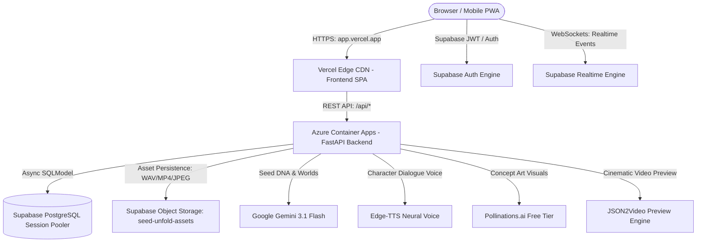

# Phase 40: Production Cloud Deployment (Azure + Vercel + Supabase)

## Phase Goal
Deploy PRAROHA as a verified, publicly accessible production application utilizing Azure Container Apps for the FastAPI backend, Vercel for the React/Vite/PWA frontend, and Supabase for persistent PostgreSQL, Object Storage, Authentication, and Realtime events.

---

## Architecture Contract

---

## Detailed Task Breakdown

### Wave 1: Repository Hardening & Decoupling (Completed)
- [x] **TASK-40-01**: Harden frontend `ApiClient` base URL normalization in `frontend/src/api/client.ts` to support `VITE_API_URL` with automatic `/api` suffix handling.
- [x] **TASK-40-02**: Implement startup orphaned job recovery in `backend/app/main.py` and `backend/app/repositories/project_repo.py` to prevent hanging jobs across container restarts.
- [x] **TASK-40-03**: Create `frontend/vercel.json` with SPA routing rewrite rules (`/(.*)` $\rightarrow$ `/index.html`) and cache-control headers for PWA assets (`sw.js`, `manifest.webmanifest`).

### Wave 2: Cloud Infrastructure Specification & Azure Deployment Preparation
- [x] **TASK-40-04**: Prepare Azure Container Apps configuration specifications using `Dockerfile.backend`, port 8000, and health probe at `/api/health`.
- [x] **TASK-40-05**: Define environment variable and secret mapping for Azure Container Apps (`GEMINI_API_KEY`, `DATABASE_URL`, `SUPABASE_*`, `PIXAZO_API_KEY`, `JSON2VIDEO_API_KEY`, `REWIND_API_KEY`, `CORS_ORIGINS`).
- [x] **TASK-40-06**: Document Vercel project configuration (`Root Directory: frontend`, `Build Command: npm run build`, `Output Directory: dist`).

### Wave 3: Verification & Operational Runbooks
- [x] **TASK-40-07**: Execute live deployment and configure Supabase Auth Site URL and Redirect URLs for the live Vercel domain.
- [x] **TASK-40-08**: Perform live HTTPS verification across fresh user registration, email verification, world creation, soundscape playback, and project reload.
- [x] **TASK-40-09**: Update `.planning/STATE.md`, `README.md`, and `docs/DEPLOYMENT.md` with live URLs, test evidence, and operational maintenance procedures.
