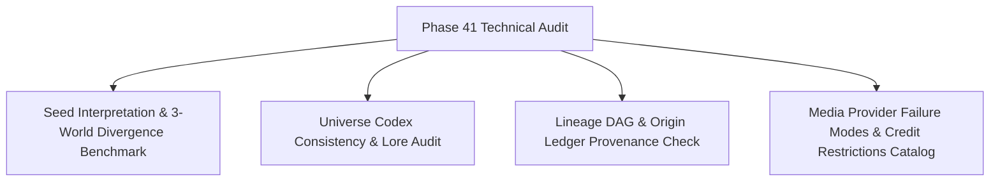

# Phase 41: Product Alignment & Technical Audit

## Phase Goal
Establish an empirical, documented baseline for seed interpretation quality, 3-world semantic divergence, universe entity consistency, lineage origin trail accuracy, and media provider credit/failure restrictions across PRAROHA.

---

## Architecture Contract & Scope

---

## Detailed Task Breakdown

### Wave 1: Seed Interpretation & Divergence Benchmark
- [x] **TASK-41-01**: Execute non-destructive evaluation across 3 contrasting creative seeds (Sci-Fi Venus, Magical Realism Clockmaker, Underwater City Demo).
- [x] **TASK-41-02**: Measure and document divergence metrics across Seed Fidelity, Novelty, Conceptual Distance, and Feasibility for World A (Familiar), World B (Radical), and World C (Inverse).
- [x] **TASK-41-03**: Assess whether Decision DNA constraints in Stage 4 properly propagate into Stage 5 universe unfolding prompts.

### Wave 2: Universe Consistency & Provenance Integrity Audit
- [x] **TASK-41-04**: Audit generated World Bible rules, character casts, relationship tensions, and scene climax beats for internal lore contradictions or character trait drift.
- [x] **TASK-41-05**: Audit the Causal Lineage DAG (`LineageService`) to verify 100% of universe entities carry valid `origin_type` annotations and traceable parent edges back to Seed DNA or Human Decisions.
- [x] **TASK-41-06**: Identify any orphaned entities, circular references, or missing provenance anchors in `OriginLedger`.

### Wave 3: Media Reliability, Cost & Failure Mode Catalog
- [x] **TASK-41-07**: Catalog exact HTTP response codes and headers from live media providers (Pollinations, Edge-TTS, Stable Audio, Hugging Face MusicGen, Pixazo, JSON2Video).
- [x] **TASK-41-08**: Document failure cascading vulnerabilities in `CompositeAudioProvider` and `CompositeVideoProvider` where 402/403/429 errors trigger unintended downstream calls.
- [x] **TASK-41-09**: Quantify duplicate asset generation caused by un-cached `MediaService.dispatch_job` invocations and specify cache-key requirements.

---

## Verification & Acceptance Criteria
1. **Audit Report**: Comprehensive audit document (`41-AUDIT-REPORT.md`) created detailing:
   - Qualitative and quantitative divergence scores across 3 seeds.
   - Lore consistency findings across world rules, characters, and scenes.
   - Lineage graph connectivity and origin classification distribution.
   - Matrix of provider error codes, credit status, and cascading risks.
2. **Zero Code Changes**: Application runtime logic, models, and dependencies remain completely unmodified during this audit phase.
3. **Zero Paid Spend**: No paid credits or unapproved API expenses incurred during evaluation.
