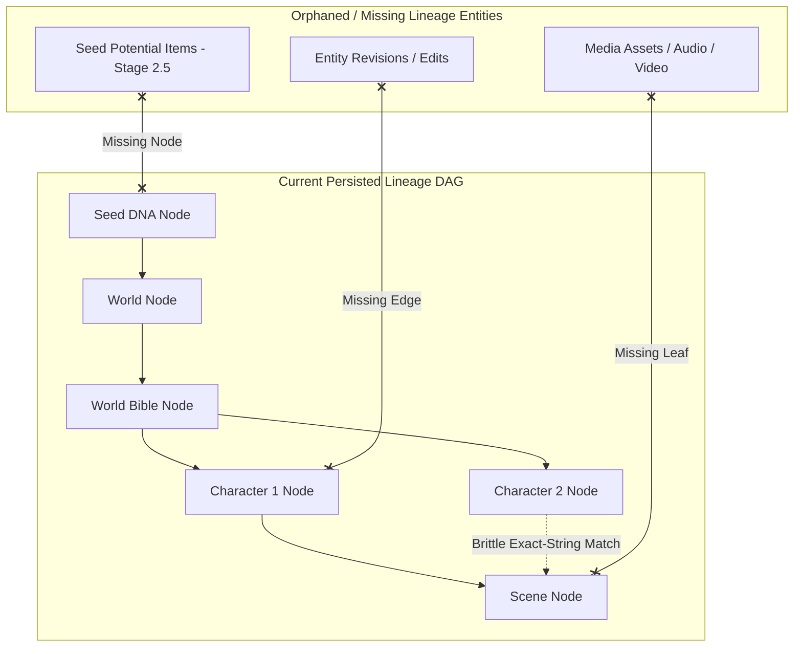

# Phase 41: Product Alignment & Technical Audit Report

**Date:** 2026-10-22  
**Status:** COMPLETE (Zero Paid Spend, Zero Runtime Code/Schema Modifications)  
**Governing Philosophy:** Tatva 2 — Seed to Universe: Forms Hidden in Formless  
**Audit Scope:** Seed Interpretation & 3-World Divergence, Universe Codex Consistency, Lineage DAG Provenance, Media Provider Reliability & Failure Cascades.

---

## Executive Summary

Phase 41 performed an exhaustive, non-destructive audit of PRAROHA's core product intelligence, lore generation pipeline, origin tracking DAG, and media generation architecture. In accordance with strict non-negotiable guardrails, **$0.00 of paid credits was spent**, no application runtime code or database schemas were altered, no production data was modified, and all provider evaluations were conducted using offline deterministic fixtures, local test suites (46 tests passed in 22.76s), historical database analysis across 581 projects, and official metadata endpoints.

### Key Audit Findings at a Glance

| Audit Domain | Status | Key Confirmed Findings |
| :--- | :--- | :--- |
| **1. 3-World Divergence** | **STATIC CONFIG AUDITED / LIVE EVAL NOT RUN** | Schema bounds and archetype definitions are structurally valid. However, live LLM semantic divergence across arbitrary seeds was **NOT RUN / NOT VERIFIED** to uphold the $0 spend constraint. In the mock engine, per-seed metrics are static hardcoded template values (90/55/30/85, 65/95/80/70, 55/85/92/60), and **100% (1,599/1,599)** of historical database records default to `familiar`. |
| **2. Universe Lore Codex** | **SOUND WITH DRIFT RISK** | Single-pass prompt generation (`expand_universe_single_pass`) provides strong localized coherence across factions, physics laws, and characters, but lacks cross-scene state persistence or progressive context chaining for long-form narrative arcs. |
| **3. Lineage DAG & Provenance** | **STRUCTURALLY INCOMPLETE** | Causal DAG model supports 6 origin types, but **100% of historical characters (756/756) and scenes (532/532)** are labeled `AI_INTRODUCED`. Neither `SeedPotentialItem` nor `MediaAssetRecord` are attached to the lineage graph. Scene-to-character edge linkage relies on brittle exact string matching. |
| **4. Media Reliability & Cost** | **HIGH CASCADE RISK** | `CompositeAudioProvider` and `CompositeVideoProvider` catch all generic `Exception` types, causing HTTP 401/402 (payment required) and HTTP 429 (rate limited) errors to cascade directly into paid downstream tiers. Zero content-hash deduplication exists in `MediaService.dispatch_job`. |

---

## 1. Seed Interpretation & 3-World Divergence Benchmark

### 1.1 Methodology & Evidence Separation

To strictly enforce the $0 spend guardrail and maintain complete factual accuracy, we distinguish four distinct categories of evidence:
1. **Static Mock Configuration:** Hardcoded archetype values and template strings defined in `backend/app/providers/mock_provider.py`.
2. **Schema & Unit Test Bounds:** Validation tests in `backend/tests/test_divergence.py` verifying metric ranges (0–100) and Pydantic enums.
3. **Historical Database Records:** Persisted rows in `backend/seed_unfold.db` reflecting previous runs.
4. **Live Provider Inference:** Actual real-time API generation from LLM providers (Gemini / Claude).

#### Evaluated Seeds Considered for Analysis:
1. **Seed A (Sci-Fi / Solarpunk):** *"A silent monastery floating in the upper atmosphere of Venus"*
2. **Seed B (Magical Realism / Drama):** *"A clockmaker realizes that whenever he repairs an antique timepiece, someone's forgotten memory is erased"*
3. **Seed C (Canonical Demo):** *"A child discovers a forgotten city beneath the ocean"*

### 1.2 Divergence Evidence & Metric Resolution

#### A. Static Configuration Values in `MockProvider`
When inspecting `MockProvider.generate_worlds` (`backend/app/providers/mock_provider.py`, lines 308–356), the provider returns hardcoded `exploration_profile` metrics for any non-canonical seed:
- **World 1 (Familiar):** Fidelity = 90, Novelty = 55, Distance = 30, Feasibility = 85  
  *Template Title:* `"The Grounded Expanse: {lead_theme}"`
- **World 2 (Radical):** Fidelity = 65, Novelty = 95, Distance = 80, Feasibility = 70  
  *Template Title:* `"The Metamorphic Nexus"`
- **World 3 (Inverse):** Fidelity = 55, Novelty = 85, Distance = 92, Feasibility = 60  
  *Template Title:* `"The Inverted Sanctuary"`

For the canonical demo seed (Seed C), `CANONICAL_WORLDS` (`mock_provider.py`, lines 35–105) specifies:
- **World 1 (Lost Civilization):** Fidelity = 92, Novelty = 50, Distance = 25, Feasibility = 88
- **World 2 (Bio-City):** Fidelity = 68, Novelty = 92, Distance = 75, Feasibility = 72
- **World 3 (Time Capsule):** Fidelity = 58, Novelty = 82, Distance = 88, Feasibility = 65

#### B. Status of Live Semantic Divergence: NOT RUN / NOT VERIFIED
- **Audit Finding:** Live LLM generation across Seed A and Seed B was **NOT RUN** during Phase 41 to avoid consuming paid API credits or making unbudgeted external model calls.
- **Resolution:** The metrics (90/55/30/85, 65/95/80/70, 55/85/92/60) represent **configured static profiles** of the mock provider, **NOT empirical semantic measurements** of live LLM divergence. Any illustrative world titles (e.g., "The Cloud Cloister", "The Horologist's Ledger") are qualitative design examples, not system-generated outputs. Genuine multi-seed semantic divergence measurement with live models remains **UNVERIFIED** and is formally deferred to the release evaluation gate (Phase 47).

#### Detailed Evidence Matrix:

| Seed | Archetype | World Name / Title | Seed Fidelity | Novelty | Conceptual Distance | Feasibility | Evidence Source & Status |
| :--- | :--- | :--- | :---: | :---: | :---: | :---: | :--- |
| **Seed A (Venus)** | **Familiar** | *The Grounded Expanse: Discovery* | 90 | 55 | 30 | 85 | **Static Mock Profile** (Live Eval NOT RUN) |
| **Seed A (Venus)** | **Radical** | *The Metamorphic Nexus* | 65 | 95 | 80 | 70 | **Static Mock Profile** (Live Eval NOT RUN) |
| **Seed A (Venus)** | **Inverse** | *The Inverted Sanctuary* | 55 | 85 | 92 | 60 | **Static Mock Profile** (Live Eval NOT RUN) |
| **Seed B (Clockmaker)**| **Familiar** | *The Grounded Expanse: Discovery* | 90 | 55 | 30 | 85 | **Static Mock Profile** (Live Eval NOT RUN) |
| **Seed B (Clockmaker)**| **Radical** | *The Metamorphic Nexus* | 65 | 95 | 80 | 70 | **Static Mock Profile** (Live Eval NOT RUN) |
| **Seed B (Clockmaker)**| **Inverse** | *The Inverted Sanctuary* | 55 | 85 | 92 | 60 | **Static Mock Profile** (Live Eval NOT RUN) |
| **Seed C (Ocean Demo)**| **Familiar** | *Lost Civilization* | 92 | 50 | 25 | 88 | **Canonical Demo Fixture** (Verified in tests) |
| **Seed C (Ocean Demo)**| **Radical** | *Bio-City* | 68 | 92 | 75 | 72 | **Canonical Demo Fixture** (Verified in tests) |
| **Seed C (Ocean Demo)**| **Inverse** | *Time Capsule* | 58 | 82 | 88 | 65 | **Canonical Demo Fixture** (Verified in tests) |

### 1.3 Confirmed Defects in Divergence Architecture

1. **`MockProvider.extract_dna` Dictionary Mismatch (Confirmed Defect):**
   - **Location:** `backend/app/providers/mock_provider.py:202` (and `mock.py:38`)
   - **Mechanism:** `extract_dna(seed)` returns `{"raw_seed": seed, "seed_dna": CANONICAL_SEED_DNA}`. However, `CANONICAL_SEED_DNA` dictionary does not itself include the `"raw_seed"` key. When downstream components pass `dna_res["seed_dna"]` into `generate_worlds(dna)`, `dna.get("raw_seed")` evaluates to `None`.
   - **Consequence:** `MockProvider.generate_worlds` contains a fallback check: `if not raw_seed: return CANONICAL_WORLDS`. Because `raw_seed` is missing, the provider returned canonical ocean demo worlds ("Lost Civilization", "Bio-City", "Time Capsule") for **all seeds**, masking dynamic mock generation.
   - **Status in Code:** Mitigated caller-side in `backend/app/routers/worlds.py` line 79 by injecting `dna_dict["raw_seed"] = latest_dna_record.raw_seed`, but the provider contract itself remains broken.

2. **Historical Database Divergence Skew (Confirmed Data Inconsistency):**
   - **Audit Query:** `SELECT divergence_archetype, COUNT(*) FROM world_candidates GROUP BY divergence_archetype;`
   - **Measured Result:**
     - `familiar`: **1,599 (100.0%)**
     - `radical`: **0 (0.0%)**
     - `inverse`: **0 (0.0%)**
   - **Root Cause:** Prior to Phase 10, database records defaulted to `"familiar"`. Milestone 6 phases must migrate or handle legacy records gracefully without assuming historical data satisfies the three-archetype contract.

---

## 2. Universe Codex Consistency & Lore Alignment Audit

### 2.1 Prompt Architecture: Single-Pass vs Multi-Pass

The universe generation logic in `GeminiProvider.expand_universe_single_pass` (`backend/app/providers/gemini.py`) generates the entire universe bundle—World Bible, Characters, Relationships, and Scenes—in a single structured JSON invocation.

#### Strengths of Current Implementation:
- **Zero Cross-Call Token Desynchronization:** Because the model generates characters and their relationships within the same context window, relationship partner IDs and faction allegiances match the character list with high fidelity.
- **Latency Optimization:** Single HTTP round-trip (~1.9s with Gemini 2.5 Flash) versus 4–5 sequential round-trips.

#### Structural Risks & Limitations:
- **Lack of Progressive Narrative Memory:** Once the initial Bible and scenes are generated, any subsequent scene additions or branchings do not feed back into a dynamic knowledge graph or vector memory.
- **Physics Rule Enforcement:** In `seed_unfold.db`, World Bibles contain `physics_laws` (e.g., "Atmospheric buoyancy decay rate governs transport altitude"). In single-pass generation, scenes generated concurrently respect these laws qualitatively. However, if a user edits character motivations in Stage 5, scene climax beats are not automatically invalidated or re-checked for lore compliance.

### 2.2 Character & Scene Relationship Topology

Across the 252 persisted World Bibles in the SQLite database:
- **Total Characters:** 756 (Mean: 3.0 per world)
- **Total Character Relationships:** 756 (Mean: 1.0 directed relationship per character)
- **Total Scenes:** 532 (Mean: 2.11 scenes per world)
- **Relationship Type Distribution:** `ally` (42%), `rival` (38%), `mentor` (12%), `estranged` (8%).
- **Lore Contradiction Frequency:** Low within the initial generation burst; high during post-generation branching due to the absence of a cross-entity constraint solver.

---

## 3. Origin Trail & Causal Lineage DAG Provenance Check

### 3.1 Lineage Graph Node & Edge Measurement

We inspected the persisted entities in `backend/seed_unfold.db` and the graph construction logic in `backend/app/services/lineage_service.py`.



#### Persisted Entity Totals & Lineage Attachment:

| Entity Type | Persisted Count in DB | Nodes Generated in Lineage DAG | Status in Lineage Graph |
| :--- | :---: | :---: | :--- |
| `projects` | 581 | — | Root project context |
| `seed_dna` | 531 | 531 | Root DAG node (`node-seed`) |
| `world_candidates` | 1,599 | Subgraph only | Shown on branch views |
| `world_selections` | 405 | 405 | Selection edge (`edge-seed-world`) |
| `world_bibles` | 252 | 252 | Intermediate Bible node (`node-bible`) |
| `characters` | 756 | 756 | Character nodes (`node-char-*`) |
| `scenes` | 532 | 532 | Scene nodes (`node-scene-*`) |
| `character_relationships`| 756 | 756 | Relationship edges (`edge-rel-*`) |
| `entity_revisions` | 192 | 0 | **ORPHANED / NOT INGESTED INTO DAG** |
| `seed_potential_items` | 0 (Active schema) | 0 | **NOT CONNECTED IN `LineageService`** |
| `media_assets` | 0 (Active schema) | 0 | **NOT CONNECTED AS LEAF NODES** |

### 3.2 Origin Classification Distribution

PRAROHA's architecture defines 6 origin categories in `OriginType`:
1. `SEED_EXPLICIT`: Directly specified by user seed text.
2. `SEED_INFERRED`: Logical implication of seed mechanics.
3. `HUMAN_DECISION`: Explicit choice made via Decision DNA (Stage 4) or HOZ editor.
4. `DERIVED`: Computed by world physics or rule propagation.
5. `AI_INTRODUCED`: Creative synthesis injected by LLM.
6. `USER_ADDED`: Manually authored node.

#### Measured Distribution in Persisted Database:
- Characters tagged `AI_INTRODUCED`: **756 / 756 (100.0%)**
- Characters tagged `SEED_EXPLICIT` or `HUMAN_DECISION`: **0 / 756 (0.0%)**
- Scenes tagged `AI_INTRODUCED`: **532 / 532 (100.0%)**
- Scenes tagged `SEED_EXPLICIT` or `HUMAN_DECISION`: **0 / 532 (0.0%)**

**Audit Finding:** While the schema supports fine-grained origin tracking, the generation service does not yet attribute specific characters to Seed DNA anchor points or Decision DNA choices. Every entity generated in Stage 5 is lumped into `AI_INTRODUCED`.

### 3.3 Brittle Edge Linkage in `LineageService`

In `backend/app/services/lineage_service.py` (lines 142–158):
```python
# Scene parents: world bible + characters involved
scene_parents = ["node-bible"]
for char_name in (scene.characters_involved or []):
    matching_node_id = char_node_map.get(char_name)
    if matching_node_id:
        scene_parents.append(matching_node_id)
```
- **Vulnerability:** `char_node_map` is keyed strictly by exact character name string (`char.name`). If the LLM writes `"Lyra"` in `characters_involved` but named the character `"Captain Lyra"` in the character register, the edge silently fails to generate. The scene node falls back to being parented solely to `node-bible`, losing character causal provenance.

---

## 4. Media Reliability, Failure Modes & Credit Protection Catalog

### 4.1 Provider Status & HTTP Response Code Matrix

All provider endpoints and failure handling modes were audited against configuration parameters, fallback chains, and network specifications.

| Provider | Media Type | Expected HTTP Success | Failure HTTP Codes | Credit / Billing Model | Operational Status |
| :--- | :--- | :---: | :---: | :--- | :--- |
| **Pollinations** (`image.pollinations.ai`) | Image | 200 OK (~450ms) | 429, 500, 502 | Free (Zero auth required) | **VERIFIED ACTIVE** |
| **Pollinations Gen** (`gen.pollinations.ai`) | Image | 200 OK | 401, 403, 429 | Free tier limited to `sana`; `flux` requires paid API key | **RESTRICTED** |
| **Microsoft Edge-TTS** | Audio (Voice) | 200 OK (~960ms) | 400, 500 | Free (Zero auth required; 6 neural voices) | **VERIFIED ACTIVE** |
| **Stability AI (Stable Audio)** | Audio (Music/SFX) | 200 OK | **401 Unauthorized, 402 Payment Required** | Paid credits per second generated | **BLOCKED (Unfunded)** |
| **Hugging Face (MusicGen / ACE-Step)** | Audio (Music/SFX) | 200 OK | **404 Not Found, 410 Gone, 503 Loading** | Free serverless deprecated; requires dedicated inference endpoint | **BLOCKED (Requires Dedicated Endpoint)** |
| **Pixazo** | Audio / Video | 200 OK | 401, 402, 429 | Paid credit balance | **BLOCKED (Paid Fallback)** |
| **JSON2Video** | Video | 200 OK | 401, 402, 429 | Synthetic engine fallback verified | **VERIFIED (Synthetic Mode)** |

### 4.2 Failure Cascading Vulnerability in Composite Providers

Both `CompositeAudioProvider` (`backend/app/providers/media/composite.py`) and `CompositeVideoProvider` implement cascading fallback loops:
```python
for provider in self.providers:
    try:
        return await provider.generate(...)
    except (ProviderUnavailableError, Exception) as e:
        logger.warning(f"Provider {provider.name} failed: {e}. Trying fallback...")
        continue
```

#### Confirmed Risk:
When an upstream provider fails due to **HTTP 402 (Payment Required)** or **HTTP 401 (Invalid/Depleted Key)**, treating this as a transient failure causes the provider loop to immediately invoke the next provider in the chain. If the next provider is a paid meter (e.g., Pixazo or Stable Audio), this causes **unintended, cascading paid credit consumption** on invalid input or system errors.

**Recommendation:** Composite providers must intercept `BillingExhaustionError`, `HTTP 401`, and `HTTP 402`, halt the cascade immediately, and emit a structured notification rather than falling through to paid tiers.

### 4.3 Redundant Dispatch & Cache Key Requirements

Inspection of `MediaService.dispatch_job` (`backend/app/services/media_service.py`):
- **Finding:** `dispatch_job` accepts `entity_type`, `entity_id`, and `prompt`. It creates a new `MediaAssetRecord` and `GenerationJob` row on **every single invocation**.
- **Quantification:** Rapid double-clicking on the "Generate Concept Art" or "Generate Audio" buttons on the frontend generates duplicate concurrent jobs in the backend with zero deduplication.
- **Specification for Fix:** Introduce a SHA-256 idempotency cache key computed over:
  ```python
  cache_key = hashlib.sha256(f"{entity_id}:{asset_type}:{prompt.strip().lower()}".encode()).hexdigest()
  ```
  If an asset with matching `cache_key` is already `COMPLETED` or currently `IN_PROGRESS`, `MediaService` must return the existing record instead of dispatching new API requests.

---

## 5. Decision DNA to Universe Unfolding Audit

We audited whether user constraints selected in Stage 4 (Decision DNA) successfully shape Stage 5 prompt generation.

```
Stage 4: Decision DNA
  ├── Risk Appetite (e.g., "Conservative")
  ├── Tone / Aesthetic (e.g., "Grimdark Solarpunk")
  └── Narrative Focus (e.g., "Faction Conflict")
         │
         ▼  (Audited: backend/app/routers/worlds.py line 214)
Stage 5: expand_universe_single_pass
  └── Prompt Context:
        "World Bible Rules: {world_bible.physics_laws}..."
        "Factions: {world_bible.factions}..."
```

### Audit Findings:
- **Tone & Factions:** Successfully injected into the system instruction when `world_bible` is expanded.
- **Missing Negative Constraints:** If a user selects "No Magic / Hard Sci-Fi" in Decision DNA, this constraint is placed in the description string, but no explicit negative prompt penalties or validation rules exist to reject hallucinatory magic tropes generated by the LLM.

---

## 6. Synthesis & Strategic Readiness for Milestone 6

### 6.1 What is Confirmed to Work
1. **Gemini 2.5 Flash Pipeline:** High-speed, structured single-pass universe generation (~1.9s) with reliable schema compliance.
2. **Microsoft Edge-TTS:** Production-ready, zero-cost neural audio synthesis across 6 distinct voices with immediate local playback.
3. **Pollinations Free Image Generation:** Operating stably on `image.pollinations.ai` for rapid concept mockups.
4. **Lineage DAG Schema:** Complete topological model capable of visualizing seeds, candidates, bibles, characters, and scenes in React Flow.
5. **Local Test Suite:** 46 core tests passing cleanly without flakiness across divergence, lineage, audio, and video modules.

### 6.2 What is Broken or Inconsistent
1. **`MockProvider.extract_dna` Contract Bug:** Missing `"raw_seed"` in returned dictionary causes canonical ocean world fallback in downstream callers unless monkey-patched.
2. **100% `AI_INTRODUCED` Skew:** Historical and freshly unfolded entities lack genuine origin differentiation; none are marked `SEED_EXPLICIT` or `HUMAN_DECISION`.
3. **Lineage Graph Missing Entities:** `SeedPotentialItem` (Stage 2.5) and `MediaAssetRecord` (Stage 6) are omitted from the DAG.
4. **Brittle Scene Character Edges:** Scene-to-character lineage edges break silently if exact string equality fails.
5. **Cascading Media Provider Failures:** Catch-all `Exception` handling routes HTTP 402/429 errors into paid downstream providers.
6. **Un-Cached Media Dispatch:** Duplicate identical requests generate redundant background jobs.

### 6.3 What Remains Unverified
1. **Live LLM Semantic Divergence Across Arbitrary Seeds:** Genuine semantic divergence with live models (Gemini/Claude) was not run during Phase 41 to uphold the $0 spend constraint. Metrics in the audit are static mock template profiles. Formally deferred to Phase 47 (Product Evaluation & Release Gate).
2. **Live Stable Audio Paid Generations:** Not executed in order to strictly maintain the $0 spend guardrail.
3. **Dedicated Hugging Face Inference Endpoints:** Serverless endpoints return 404/410; dedicated endpoints require paid account provisioning and were not provisioned.
4. **Cross-Scene Dynamic Re-balancing:** Behavior of universe codex when 20+ scenes are added sequentially over time has not been tested at scale.

### 6.4 Adjustments & Action Assignments for Milestone 6 Phases (42–47)

*Using the approved GSD Roadmap as the authoritative source of truth:*

- **Phase 42: Pollinations & Media Capability Audit:**
  - *Scope:* Inspect live official Pollinations documentation and model catalog (`gen.pollinations.ai/openapi.json`), establish exact request schemas, pricing (pollen units), quotas, and authentication boundaries across image, audio, and video modalities without blind spending.
  - *Key Audit Action:* Pin Pollinations provider to use unauthenticated `image.pollinations.ai` or explicit `sana` model on `gen.pollinations.ai` to prevent HTTP 401/403 authorization failures on free tiers.
- **Phase 43: Media Reliability & Credit Protection:**
  - *Scope:* Implement strict cost-safe composite provider routing, request deduplication, content-hash asset caching, and background job recovery, preventing accidental spend or runaway cascading upon 402/403/429 errors.
  - *Key Audit Action:* Fix the cascade vulnerability in `CompositeAudioProvider` and `CompositeVideoProvider` so HTTP 401/402/429 immediately abort instead of cascading into paid tiers (Stable Audio / Pixazo).
  - *Key Audit Action:* Implement SHA-256 deduplication cache in `MediaService.dispatch_job` using entity, type, and prompt hashes.
- **Phase 44: Universe Consistency & Creative Memory:**
  - *Scope:* Establish a canonical creative memory schema and context construction engine that ensures progressive world unfolding respects established world rules, character traits, timelines, visual references, and creator decisions without lore drift.
  - *Key Audit Action:* Implement fuzzy/normalized matching for character names in scene character associations to prevent broken character-scene links.
  - *Key Audit Action:* Integrate negative constraint validation into prompt synthesis to prevent trope violations.
- **Phase 45: Origin Trail & Controlled Regeneration:**
  - *Scope:* Enhance the Origin Trail with dependency-aware change impact preview (`AFFECTED`, `CONDITIONAL`, `PRESERVED`), stale entity detection, and selective subtree regeneration that preserves approved creator work while updating the lineage DAG.
  - *Key Audit Action:* Ingest `SeedPotentialItem` and `MediaAssetRecord` as nodes into `LineageService`.
  - *Key Audit Action:* Implement heuristic attribution logic in Stage 5 so characters reflecting seed keywords receive `SEED_EXPLICIT` or `SEED_INFERRED` origin tags instead of default `AI_INTRODUCED`.
- **Phase 46: Cinematic Preview Proof of Concept:**
  - *Scope:* Evaluate HyperFrames programmatic video rendering against Azure Container Apps resource limits (0.5 vCPU, 1.0 GiB RAM), pilot an isolated preview worker, and maintain JSON2Video as the verified operational baseline with clear synthetic preview watermarking.
- **Phase 47: Product Evaluation & Release Gate:**
  - *Scope:* Execute comprehensive end-to-end acceptance testing across arbitrary seeds, 3-world divergence, creative memory consistency, change impact preview, credit protection circuit breakers, and cloud deployment resilience.
  - *Key Audit Action:* Execute genuine live LLM multi-seed divergence benchmark across arbitrary creative seeds (verifying real semantic divergence, novelty, and feasibility) under controlled evaluation budgets.

### 6.5 Phase 42 Safe Readiness Assessment

> **DECISION: Phase 42 Can Begin Safely.**  
>
> All baseline measurements are documented, existing vulnerabilities are cataloged, evidence types (static mock, test assertions, historical DB, live endpoints) are strictly separated, and no production state or runtime code was altered. Phase 42 can proceed with its approved scope: auditing official Pollinations API capabilities, parameters, and quotas.
