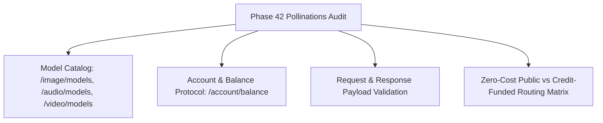

# Phase 42: Pollinations & Media Capability Audit

## Phase Goal
Inspect live official Pollinations documentation and model catalog (`gen.pollinations.ai/openapi.json`), establish exact request schemas, pricing (pollen units), quotas, and authentication boundaries across image, audio, and video modalities without blind spending.

---

## Architecture Contract & Scope

---

## Detailed Task Breakdown

### Wave 1: Official Catalog & Endpoint Schema Mapping
- [ ] **TASK-42-01**: Retrieve and parse the live model catalog from `gen.pollinations.ai` for image (`/image/models`), audio (`/audio/models`), and video (`/video/models`).
- [ ] **TASK-42-02**: Document exact request payload structures, query parameters (seed, width, height, nologo, enhance, model), and expected MIME types.
- [ ] **TASK-42-03**: Verify authentication token schemes (`bearerAuth` with `pk_` or `sk_` headers) vs unauthenticated public requests.

### Wave 2: Account Balance & Quota Mechanics
- [ ] **TASK-42-04**: Map the `GET /account/balance` schema and determine how pollen units correspond to generation requests.
- [ ] **TASK-42-05**: Specify pre-flight credit checks to verify account solvency before initiating paid requests.
- [ ] **TASK-42-06**: Define error status code handling: HTTP 401 (unauthorized key), HTTP 402 (insufficient pollen), HTTP 429 (rate-limited).

### Wave 3: Zero-Cost vs Funded Routing Policy
- [ ] **TASK-42-07**: Define policy for unauthenticated environments: strictly restrict image requests to public zero-cost models (`sana`) and disable paid video models.
- [ ] **TASK-42-08**: Define policy for authenticated environments with active key: enable premium models (`flux`, `seedance`) only when balance exceeds request threshold.
- [ ] **TASK-42-09**: Document comparison between Edge-TTS and Pollinations speech endpoint to prevent redundant voice provider complexity.

---

## Verification & Acceptance Criteria
1. **Capability Matrix**: Document `docs/POLLINATIONS_CAPABILITY_MATRIX.md` detailing:
   - Full list of live image, audio, and video models.
   - Exact URL schemes, parameters, and authentication headers.
   - Cost in pollen per model and public access restrictions.
2. **Zero Waste**: Zero generation credits expended on trial-and-error endpoint discovery.
3. **Formal Specification**: Ready-to-implement routing contract for Phase 43.
