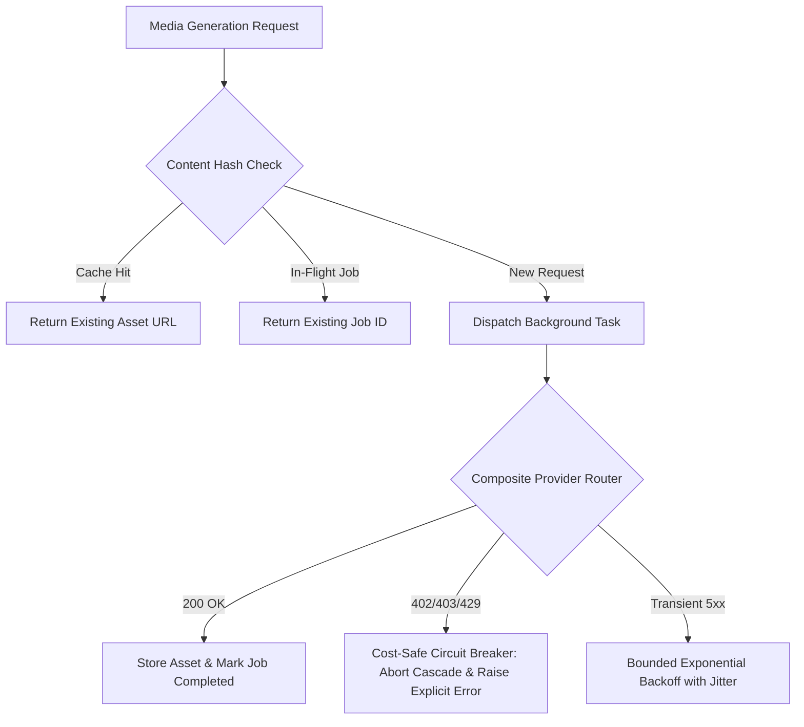

# Phase 43: Media Reliability & Credit Protection

## Phase Goal
Implement strict cost-safe composite provider routing, request deduplication, content-hash asset caching, and background job recovery, preventing accidental credit spend or runaway cascading upon 402/403/429 errors.

---

## Architecture Contract & Scope

---

## Detailed Task Breakdown

### Wave 1: Cost-Safe Circuit Breakers in Composite Providers
- [x] **TASK-43-01**: Define explicit provider exceptions: `PaymentRequiredError` (402), `QuotaExceededError` (429), and `AuthenticationError` (401/403).
- [x] **TASK-43-02**: Update `CompositeAudioProvider` to halt cascading immediately upon encountering 401, 402, 403, or 429 from any paid tier.
- [x] **TASK-43-03**: Update `CompositeVideoProvider` to prevent fallback from Wan2.1/Pyramid Flow to commercial providers (Pixazo/Rewind) when payment is required.

### Wave 2: MediaService Request Deduplication & Content Hashing
- [x] **TASK-43-04**: Add `request_hash` column to `MediaAssetRecord` and index it for fast lookup.
- [x] **TASK-43-05**: Implement deduplication check in `MediaService.dispatch_job`: return existing completed asset or attach to existing active `generation_jobs` record.
- [x] **TASK-43-06**: Add optional `force_regenerate: bool = False` flag to bypass cache when the user explicitly clicks "Regenerate".

### Wave 3: Bounded Retries & Container Restart Recovery
- [x] **TASK-43-07**: Configure bounded retries (max 2 attempts) with exponential backoff and jitter strictly for transient 502/503/504 errors.
- [x] **TASK-43-08**: Harden `recover_orphaned_jobs` in `ProjectRepository` to ensure container restarts mark uncompleted jobs as `failed` with clear retryable status.
- [x] **TASK-43-09**: Expose provider status in backend responses showing real-time health and credit availability errors.

---

## Verification & Acceptance Criteria
1. **Circuit Breaker Test**: Simulated HTTP 402 response from Tier 1 provider halts execution immediately without attempting Tier 2 or Tier 3 paid providers.
2. **Deduplication Test**: Dispatching 3 consecutive requests with identical parameters produces exactly 1 background job and returns the same asset.
3. **Recovery Test**: Interrupted jobs in PostgreSQL transition to failed state with retry button upon backend startup.
4. **Test Suite**: Automated tests in `backend/tests/test_media_reliability.py` pass 100%.
