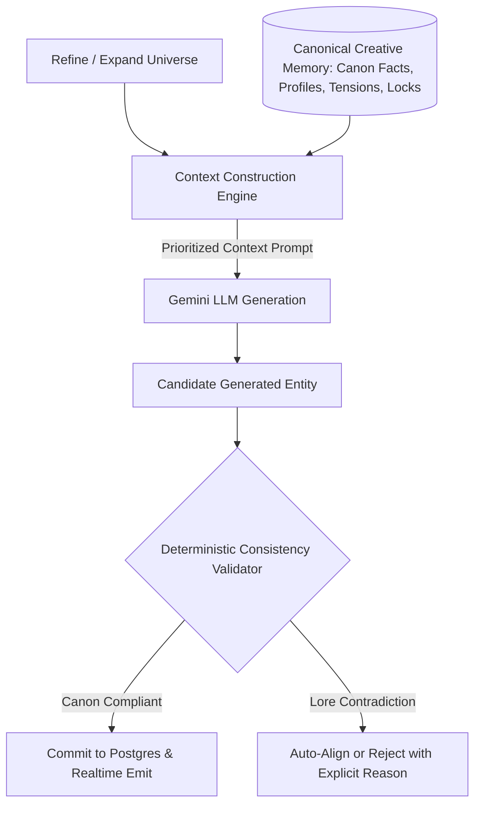

# Phase 44: Universe Consistency & Creative Memory

## Phase Goal
Establish a canonical creative memory schema and context construction engine that ensures progressive world unfolding and subsequent generations respect established world rules, character traits, timelines, visual references, and creator decisions without lore drift.

---

## Architecture Contract & Scope

---

## Detailed Task Breakdown

### Wave 1: Canonical Creative Memory Schema
- [ ] **TASK-44-01**: Design `CreativeMemoryRecord` in `backend/app/models/memory.py` capturing canon rules, character traits, relationships, timeline constraints, and creator locks.
- [ ] **TASK-44-02**: Implement automatic extraction and synchronization into `CreativeMemoryRecord` whenever a World Bible or Human-Only Zone is saved.
- [ ] **TASK-44-03**: Expose `GET /api/projects/{project_id}/memory` endpoint for client inspection and debugging.

### Wave 2: Context Construction Engine
- [ ] **TASK-44-04**: Implement `ContextConstructionService` in `backend/app/services/context_service.py` to compile prioritized, token-capped memory summaries.
- [ ] **TASK-44-05**: Inject active memory context into generation prompts for:
  - Character refinement and new character introduction.
  - Scene generation and dramatic beat expansion.
  - Visual concept art prompt synthesis.
- [ ] **TASK-44-06**: Ensure context builder respects prompt token budgets (< 2,000 tokens) to maintain low latency and low API cost.

### Wave 3: Deterministic Consistency Validator
- [ ] **TASK-44-07**: Build `ConsistencyValidator` verifying generated entities against `canon_facts` and `HumanOnlyZones`.
- [ ] **TASK-44-08**: Ensure character motivations in scenes match established character profiles.
- [ ] **TASK-44-09**: Add automated tests in `backend/tests/test_creative_memory.py` asserting zero lore drift and complete creator lock enforcement.

---

## Verification & Acceptance Criteria
1. **Memory Synchronization**: Updating a World Bible rule automatically updates the project's canonical `CreativeMemoryRecord`.
2. **Consistency Enforcement**: Generating a downstream scene with a character forces alignment with that character's established motivation and flaws.
3. **No Vector DB Bloat**: 100% of memory and consistency checks operate directly on PostgreSQL without external vector services.
4. **Test Verification**: Pytest suite validates zero lore regression across 10 multi-generation tests.
