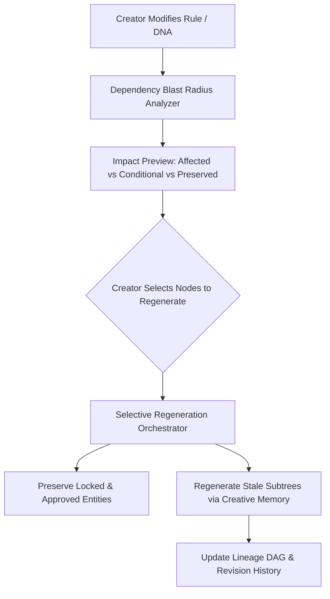

# Phase 45: Origin Trail & Controlled Regeneration

## Phase Goal
Enhance the Origin Trail with dependency-aware change impact preview (`AFFECTED`, `CONDITIONAL`, `PRESERVED`), stale entity detection, and selective subtree regeneration that preserves approved creator work while updating the lineage DAG.

---

## Architecture Contract & Scope

---

## Detailed Task Breakdown

### Wave 1: Dependency Blast Radius & Impact Preview
- [ ] **TASK-45-01**: Implement `DependencyGraphService` in `backend/app/services/dependency_service.py` to traverse parent-child relationships across Seed DNA, World Bible rules, characters, relationships, and scenes.
- [ ] **TASK-45-02**: Build `POST /api/projects/{project_id}/lineage/impact-preview` endpoint returning node classifications: `AFFECTED`, `CONDITIONAL`, `PRESERVED`.
- [ ] **TASK-45-03**: Create frontend change impact preview dialog in `frontend/src/components/workspace/ChangeImpactModal.tsx`.

### Wave 2: Stale Entity Detection & Selective Regeneration
- [ ] **TASK-45-04**: Add `is_stale: bool` flag and `stale_reason: Optional[str]` to universe entities (`CharacterRecord`, `SceneRecord`, `WorldBibleRecord`).
- [ ] **TASK-45-05**: Implement `POST /api/projects/{project_id}/regenerate-selective` endpoint accepting a list of entity IDs to re-synthesize.
- [ ] **TASK-45-06**: Ensure selective regeneration passes the project's `CreativeMemoryRecord` and preserved peer entities to maintain world continuity.

### Wave 3: Lineage DAG Updates & Revision History
- [ ] **TASK-45-07**: Update `LineageService.build_project_lineage` to accurately record regeneration parent links and revision numbers (`v2`, `v3`).
- [ ] **TASK-45-08**: Ensure Origin Ledger explanations accurately state when an entity was regenerated to honor an upstream change.
- [ ] **TASK-45-09**: Write integration tests in `backend/tests/test_controlled_regeneration.py` validating that selective regeneration leaves untouched entities identical in memory and database.

---

## Verification & Acceptance Criteria
1. **Impact Preview**: Changing a World Bible physical law accurately identifies scenes relying on that law as `AFFECTED`, while independent character backstory nodes remain `PRESERVED`.
2. **Selective Execution**: Regenerating an affected character updates that character's record without touching or wiping out other characters or scenes.
3. **Lineage Accuracy**: The Causal Lineage DAG visualizes the updated dependency edge and increments the revision indicator.
4. **Creator Protection**: Locked Human-Only Zones cannot be marked for regeneration without explicit unlock confirmation.
