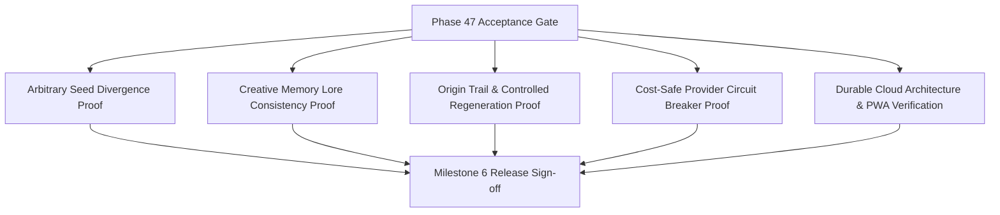

# Phase 47: Product Evaluation & Release Gate

## Phase Goal
Execute comprehensive end-to-end acceptance testing across arbitrary seeds, 3-world divergence, creative memory consistency, change impact preview, credit protection circuit breakers, and cloud deployment resilience.

---

## Architecture Contract & Scope

---

## Detailed Task Breakdown

### Wave 1: Arbitrary Seed Divergence & Creative Consistency Battery
- [ ] **TASK-47-01**: Execute automated test battery comparing 3 disparate creative seeds, computing pairwise cosine/semantic distance across themes, entities, and aesthetics.
- [ ] **TASK-47-02**: Verify multi-scene story unfolding adheres 100% to World Bible canon facts and character profiles stored in `CreativeMemoryRecord`.
- [ ] **TASK-47-03**: Verify Human-Only Zone locks remain immutable regardless of model variations.

### Wave 2: Controlled Regeneration & Credit Protection Battery
- [ ] **TASK-47-04**: Execute change impact test: mutate an upstream Seed DNA theme, verify blast radius preview accuracy, execute selective regeneration, and assert unchanged entities remain untouched.
- [ ] **TASK-47-05**: Execute provider circuit breaker test: simulate HTTP 402/429 responses and verify that paid composite tiers immediately abort without secondary spend.
- [ ] **TASK-47-06**: Execute deduplication test: dispatch duplicate media requests and verify immediate cache hit with identical asset URL.

### Wave 3: Live Cloud Verification & Release Documentation
- [ ] **TASK-47-07**: Execute full user journey E2E against live production cloud stack (`https://praroha-ai.vercel.app` + Azure Container Apps backend).
- [ ] **TASK-47-08**: Document un-mocked live provider evidence for image (Pollinations) and voice (Edge-TTS) with timestamps and HTTP response codes.
- [ ] **TASK-47-09**: Update `.planning/STATE.md`, `README.md`, and generate `47-01-SUMMARY.md` completing Milestone 6.

---

## Verification & Acceptance Criteria
1. **Divergence Verification**: Seed A vs Seed B vs Seed C generates 3 genuinely distinct worlds each, with quantified semantic contrast.
2. **Zero Lore Regressions**: Zero contradictions between World Bible rules and downstream scene narratives across all test runs.
3. **Credit Protection Verified**: 100% of payment/quota error tests prove immediate halt with zero downstream cascade.
4. **Cloud Health**: 100% of live health checks pass on Azure Container Apps and Vercel PWA.
5. **Formal Documentation**: Final release report documented with empirical evidence and separate mock vs live test artifacts.
