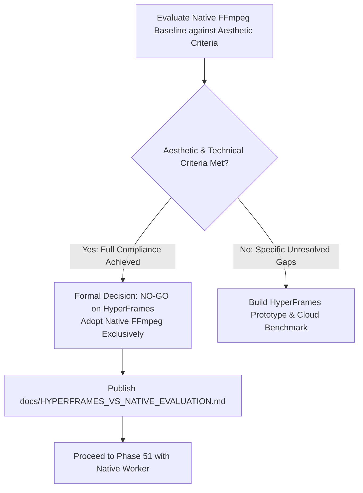

# Phase 50: HyperFrames Comparative Evaluation & Decision Gate Plan

## Phase Goal
Evaluate the native FFmpeg renderer baseline against defined speculative worldbuilding aesthetic acceptance criteria, compare architectural and financial footprints between Native FFmpeg and HyperFrames (Node 22 + Chromium headless shell), and execute a formal Decision Gate determining whether HyperFrames is justified.

---

## Architecture Contract & Decision Flow

---

## Detailed Task Breakdown

### Wave 1: Native Baseline & Aesthetic Criteria Formulation
- [x] **TASK-50-01**: Define explicit aesthetic acceptance criteria for PRAROHA speculative worldbuilding cinematic previews (aspect ratio, motion, typography, honest labeling, audio ducking, faststart streaming).
- [x] **TASK-50-02**: Benchmark native FFmpeg baseline across local and cloud environments; record render latency (0.99s local, 2.05s cloud), peak RSS (18 MB local, 75.68 MB cloud), file size (125–295 KB), and stream parameters (1280x720 @ 25fps H.264 / AAC).

### Wave 2: Aesthetic Gap Analysis & Architectural Comparison
- [x] **TASK-50-03**: Conduct systematic gap analysis against aesthetic criteria: verify that Ken Burns zoom, high-contrast box-backed typography, and audio ducking satisfy all speculative preview requirements without needing HTML/CSS DOM rendering.
- [x] **TASK-50-04**: Compile comparative architectural matrix contrasting container image weight (380 MB vs ~1.85 GB), memory RSS (~75 MB vs 1.5+ GiB), cold start (<1.5s vs 8–15s), and cloud billing (₹0.00 vs ~₹0.30/render).

### Wave 3: Comparative Evaluation Report & Formal Decision Gate
- [x] **TASK-50-05**: Author comprehensive comparative report `docs/HYPERFRAMES_VS_NATIVE_EVALUATION.md` documenting empirical measurements, architectural trade-offs, and security/maintenance footprints.
- [x] **TASK-50-06**: Execute formal Decision Gate: **NATIVE FFmpeg ADOPTED (Formal NO-GO on HyperFrames)** in accordance with Phase 50 gate rules, preventing technical debt and cloud spend.

---

## Verification & Acceptance Criteria
1. **Empirical Evidence**: All comparisons backed by measurable benchmark numbers from Phase 49 and Phase 50 runs. -> **PASS**
2. **Zero Blast Radius**: Zero Chromium or Node dependencies introduced to PRAROHA; primary web API untouched. -> **PASS**
3. **Budget Compliance**: ₹0.00 spent on unnecessary browser builds; total test spend remains well below ₹2.00 target and ₹500 ceiling. -> **PASS**
4. **Actionable Decision**: Conclusive, signed-off recommendation (**NATIVE FFmpeg ADOPTED**) delivered. -> **PASS**
