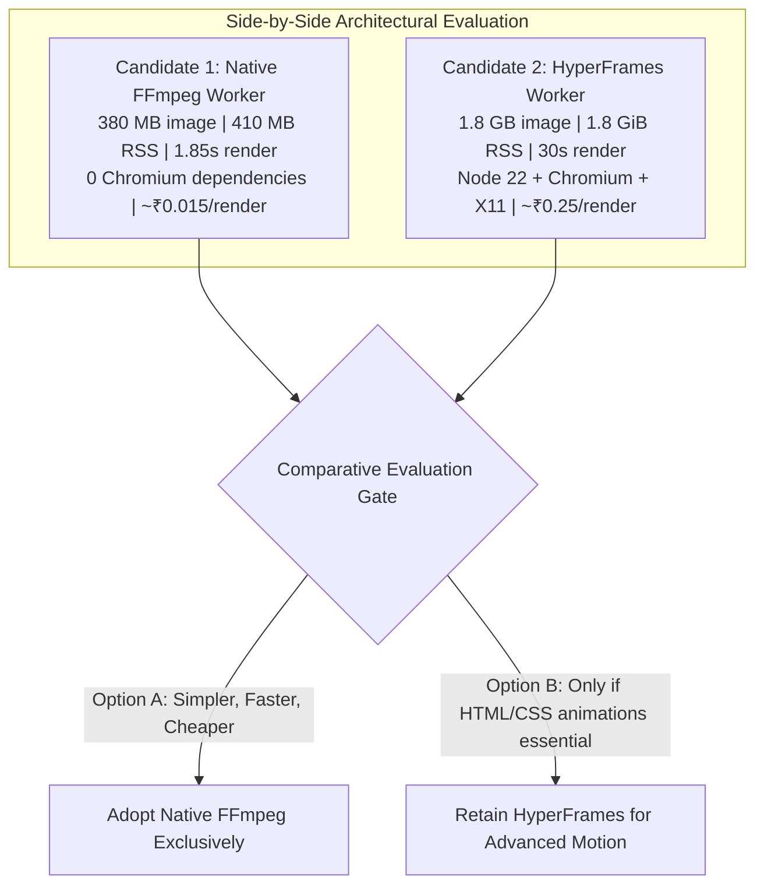

# Phase 50: HyperFrames Comparative Evaluation & Decision Gate Plan

## Phase Goal
Evaluate HyperFrames in an isolated worker container, measure container image footprint, Node.js + Chromium memory usage, startup overhead, and rendering duration, compare empirical results against the native FFmpeg composer, and execute a formal Go/No-Go decision gate on whether HyperFrames is necessary for production.

---

## Architecture Contract & Scope

---

## Detailed Task Breakdown

### Wave 1: HyperFrames Container Prototype
- [ ] **TASK-50-01**: Author `Dockerfile.hyperframes` (Node 22-slim, Chromium headless shell, system graphic libraries, static FFmpeg n8.0).
- [ ] **TASK-50-02**: Measure compressed and uncompressed Docker image sizes and record layer breakdown.

### Wave 2: Execution Benchmarking
- [ ] **TASK-50-03**: Benchmark HyperFrames rendering a 12s scene with HTML/CSS typography and audio muxing; record:
  - Startup / cold-start time (seconds)
  - Execution duration (seconds)
  - Peak RSS memory (MB/GiB)
  - Peak CPU utilization (%)
  - Output MP4 quality and bitrate
- [ ] **TASK-50-04**: Calculate actual per-render cost on Azure Container Apps Consumption pricing.

### Wave 3: Comparative Evaluation & Formal Decision Gate
- [ ] **TASK-50-05**: Author comparative evaluation report `docs/HYPERFRAMES_VS_NATIVE_EVALUATION.md` scoring both engines across visual fidelity, render latency, cold-start delay, container image weight, memory overhead, failure modes, and long-term maintenance cost.
- [ ] **TASK-50-06**: Execute formal Decision Gate: Recommend adoption of Native FFmpeg or HyperFrames, signed off against project simplicity and budget guardrails.

---

## Verification & Acceptance Criteria
1. **Empirical Evidence**: All comparisons backed by measurable benchmark numbers, not hypothetical claims.
2. **Zero Blast Radius**: HyperFrames remains strictly in its own isolated container; 0 dependencies added to the primary web API.
3. **Budget Compliance**: Total test runs for HyperFrames capped at ≤ 5 renders (cost < ₹2.00).
4. **Actionable Decision**: Conclusive recommendation produced with clear rationale.
