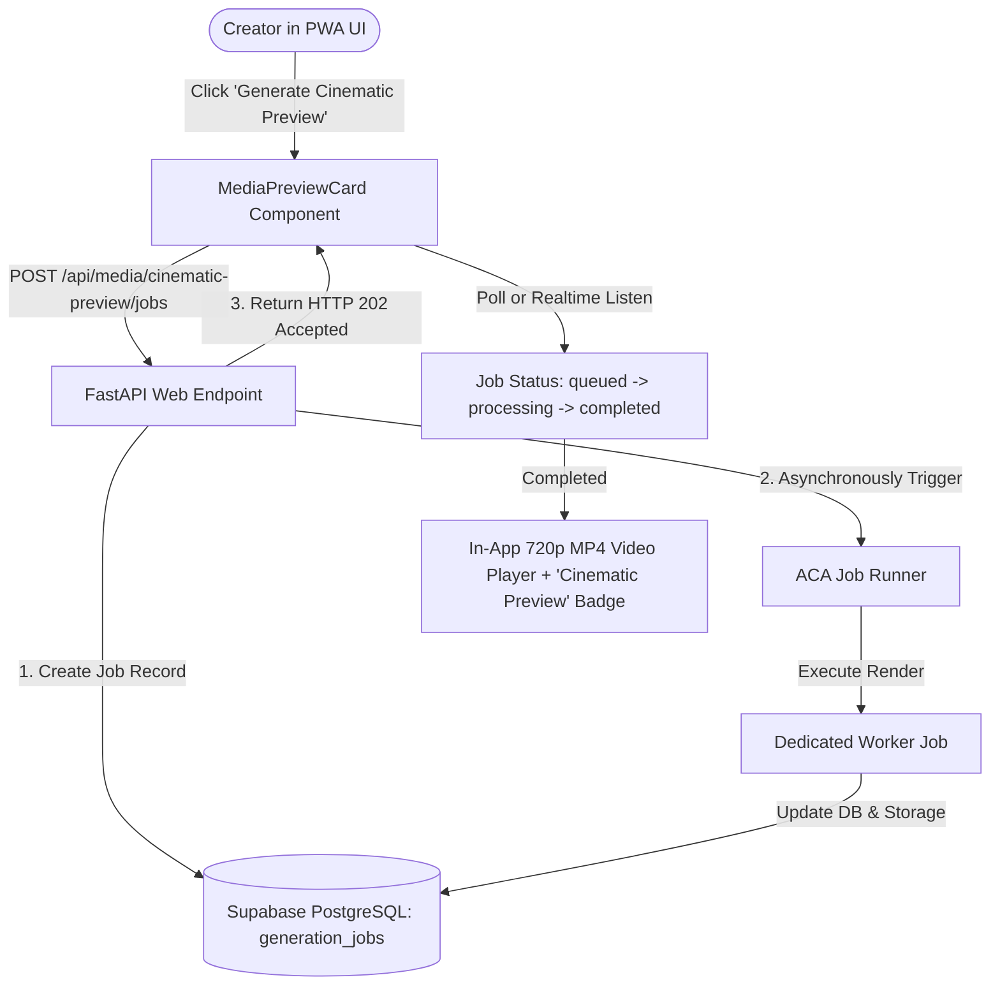

# Phase 51: Production Dispatch, UI Enablement & Release Gate Plan

## Phase Goal
Connect the verified on-demand cinematic rendering worker to the PRAROHA web application via non-blocking API dispatch, safely enable the frontend preview generation UI with honest synthetic badges, execute full end-to-end user lifecycle verification, and approve the Milestone 7 release gate.

---

## Architecture Contract & Scope

---

## Detailed Task Breakdown

### Wave 1: Non-Blocking Dispatch API
- [ ] **TASK-51-01**: Implement `/api/media/cinematic-preview/jobs` endpoint in `backend/app/api/endpoints/media.py`:
  - Validates request and checks `request_hash` for existing rendered assets.
  - Creates a `generation_jobs` record with `status="queued"`.
  - Dispatches an asynchronous non-blocking trigger to the ACA Job.
  - Returns `202 Accepted` with `job_id` and initial status.
- [ ] **TASK-51-02**: Ensure the web container does NOT import FFmpeg, Chromium, or video rendering libraries.

### Wave 2: Frontend UI Enablement & Honest Badging
- [ ] **TASK-51-03**: Update `frontend/src/components/media/MediaPreviewCard.tsx`:
  - Re-enable the "Generate Cinematic Preview" button from its disabled/offline state.
  - Implement loading spinner, elapsed time counter, and error handling states.
  - Display the verified **`Cinematic Preview`** badge (`bg-[#F2EBDD] text-[#6E5D4F] border-[#D8CCB7]`) with clear explanatory tooltip.
- [ ] **TASK-51-04**: Embed in-app HTML5 video player for completed MP4 previews with playback controls, loop toggle, and download action.

### Wave 3: End-to-End Verification & Milestone 7 Release Gate
- [ ] **TASK-51-05**: Execute full-journey E2E test: seed input -> world divergence -> world selection -> codex unfolding -> cinematic preview generation -> video playback.
- [ ] **TASK-51-06**: Verify zero regression across all 230 existing backend tests, PWA build, and creative memory consistency.
- [ ] **TASK-51-07**: Execute formal Milestone 7 Release Gate audit, document final metrics in `docs/MILESTONE_7_RELEASE.md`, and obtain production deployment sign-off.

---

## Verification & Acceptance Criteria
1. **End-to-End Success**: Creator can request, wait, and view a completed cinematic preview directly in the PWA.
2. **Performance Integrity**: Web API latency remains < 100ms for status polling; 0 memory leaks or process crashes.
3. **Honest Labeling**: Output retains explicit `is_synthetic: true` metadata and never claims diffusion AI provenance.
4. **Budget Adherence**: Total project spend throughout Milestone 7 stays strictly within the ₹500 target allocation.
