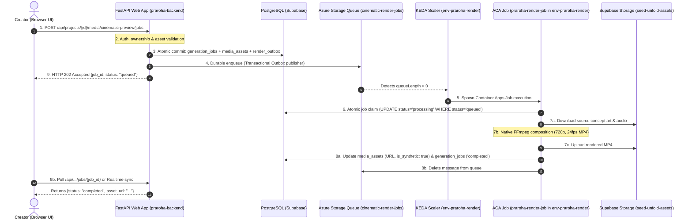

# Message Schema & Durable 9-Step Lifecycle Specification

## 1. Queue Message Schema

The queue message is designed to be lightweight, deterministic, and strictly decoupled from secrets.

### Security Boundary: Zero Credentials in Messages
Under no circumstances are database credentials, Supabase API keys, JWT tokens, or worker authentication tokens included in queue messages. The worker container authenticates to cloud services using its own runtime environment variables and secrets configured within Azure Container Apps.

### JSON Payload Specification
```json
{
  "$schema": "https://praroha.app/schemas/cinematic-render-job.v1.json",
  "schema_version": "1.0",
  "job_id": "7f8b894d-5872-4632-9cb7-7bc8ff3a97a1",
  "project_id": "3b290cb7-3162-4217-a5ec-9042b322dafa",
  "entity_type": "world",
  "entity_id": "18f91ea7-d150-42cf-9ca3-18cb9b010c73",
  "request_hash": "a5e8412ff35b91a78465a31a9829cf9a896d8e23f99b21f37b198124b6f79021",
  "options": {
    "duration_seconds": 6,
    "fps": 24,
    "resolution": "1280x720",
    "motion_preset": "slow_pan"
  },
  "enqueued_at": "2026-10-22T21:30:00.000Z",
  "attempt": 1
}
```

### Field Definitions & Validation Rules

| Field | Type | Required | Description | Validation Rule |
| :--- | :--- | :--- | :--- | :--- |
| `schema_version` | String | Yes | Version of message contract | Must equal `"1.0"` |
| `job_id` | UUID | Yes | Primary key in `generation_jobs` table | Standard UUID v4 |
| `project_id` | UUID | Yes | Project scope identifier | Must exist in `projects` |
| `entity_type` | String | Yes | Target entity type (`world`, `character`, `scene`) | Regex: `^(world\|character\|scene)$` |
| `entity_id` | UUID | Yes | Identifier of entity being rendered | Standard UUID v4 |
| `request_hash` | String | Yes | SHA-256 fingerprint of prompt + asset inputs | 64-character lowercase hex |
| `options` | Object | No | Rendering parameters | Duration 1–10s, resolution 720p |
| `enqueued_at` | ISO 8601 | Yes | UTC timestamp when published | Valid UTC ISO string |
| `attempt` | Integer | Yes | Initial enqueue counter | Must equal `1` when enqueued |

- **Message Size**: ~450 bytes (well below Azure Storage Queue 64 KB limit).
- **Encoding**: UTF-8 Base64-encoded string (native Azure Queue standard).

---

## 2. Complete 9-Step Durable Lifecycle



### Detailed Lifecycle Steps

#### Step 1: User Request & Authentication
- Creator clicks "Generate Cinematic Preview" in `EntityMediaSection.tsx`.
- Request hits `POST /api/projects/{project_id}/media/cinematic-preview/jobs`.
- FastAPI authenticates caller via JWT (`get_current_user`).

#### Step 2: Project Ownership & Asset Validation
- API verifies caller owns or has member access to `project_id`.
- API checks whether source visual assets (concept art) and soundscapes exist for `entity_id`.
- API verifies that no active job (`status IN ('queued', 'processing')`) already exists for this `(project_id, request_hash)`.

#### Step 3: Atomic Database Record Creation
- Primary API initiates a database transaction:
  1. Inserts into `generation_jobs`: `id = job_id`, `status = 'queued'`, `request_hash = hash`.
  2. Inserts into `media_assets`: `status = 'pending'`, `asset_type = 'video'`, `provider_label = 'Cinematic Preview'`, `is_synthetic = true`.
  3. Inserts into `render_outbox`: `job_id = job_id`, `payload = JSON`, `published = false`.
- Transaction commits atomically. If the database fails, the request halts with HTTP 500 and no message is ever sent to the queue.

#### Step 4: Durable Enqueue (Transactional Outbox Pattern)
- Immediately post-commit, the API publishes the message to Azure Storage Queue `cinematic-render-jobs`.
- On successful enqueue, the API marks `render_outbox.published = true`.
- *Resilience Guarantee*: If the API process is killed immediately after DB commit but before queue send, the startup recovery sweeper in `backend/app/main.py` scans `render_outbox WHERE published = false AND created_at < now() - INTERVAL '1 minute'` and finishes the enqueue safely.

#### Step 5: KEDA Event Scaling & Worker Execution Spawn
- Built-in KEDA scaler in `env-tendersaathi` polls `cinematic-render-jobs` (interval: 15s).
- Detecting queue length $\ge 1$, KEDA triggers an execution of `praroha-render-job` (`min-executions: 0`, `max-executions: 2`).

#### Step 6: Worker Claim & Lock
- The worker container starts and receives the message.
- Worker executes an atomic SQL claim:
  ```sql
  UPDATE generation_jobs 
  SET status = 'processing', started_at = NOW(), worker_id = :worker_id
  WHERE id = :job_id AND status = 'queued';
  ```
- If `rows_affected == 0`, another worker instance already claimed the job or it was canceled; the worker acknowledges and discards the message safely.

#### Step 7: Asset Fetch, Native FFmpeg Rendering & Upload
- Worker downloads the source image and audio stems into an isolated temporary directory (`/tmp/render_<job_id>/`).
- Native FFmpeg binary executes the composition pipeline (slow pan/zoom effect, 24 fps, AAC audio muxing, 720p H.264 MP4).
- Rendered MP4 is uploaded to Supabase Storage bucket `seed-unfold-assets` under `cinematic-previews/<project_id>/<job_id>.mp4`.
- Temporary scratch directory is cleanly deleted in a `finally` block.

#### Step 8: Database Finalization & Queue Acknowledgment
- Worker updates `media_assets`:
  - `status = 'completed'`
  - `public_url = <supabase_storage_url>`
  - `is_synthetic = true`
  - `provider_label = 'Cinematic Preview'`
  - `generation_metadata = { "duration": 6.0, "fps": 24, "renderer": "ffmpeg_native" }`
- Worker updates `generation_jobs`: `status = 'completed'`, `completed_at = NOW()`.
- Worker calls Azure Queue `DeleteMessage(message_id, pop_receipt)`.

#### Step 9: Immediate HTTP 202 Response & Client Observability
- Note that Step 9 was returned to the client right after Step 4. The client receives:
  ```json
  {
    "status": "queued",
    "job_id": "7f8b894d-5872-4632-9cb7-7bc8ff3a97a1",
    "message": "Cinematic preview generation enqueued successfully."
  }
  ```
- The frontend client polls `/api/projects/{id}/media/cinematic-preview/jobs/{job_id}` every 3 seconds or listens via Supabase Realtime broadcast until `status === 'completed'`.

---

## 3. Job State-Transition Matrix

| Current State | Event | Target State | Action / Side Effect |
| :--- | :--- | :--- | :--- |
| **None** | Client calls POST /jobs | `queued` | Insert DB record + render_outbox; enqueue to Storage Queue. |
| `queued` | Worker claims message | `processing` | Set `started_at = NOW()`; lease message for 300s. |
| `processing` | Render & upload succeed | `completed` | Set `completed_at = NOW()`, update `media_assets`, delete queue message. |
| `processing` | Unhandled error in worker | `failed` | Clear `request_hash = NULL`, record error reason, delete or dead-letter message. |
| `processing` | Worker hard crash / OOM | `queued` (retry) | Visibility timeout (300s) expires; message returns to queue; `dequeue_count` increments. |
| `queued` | `dequeue_count > 3` | `failed` | Move to `cinematic-render-poison`; set job to `failed` (`"Exceeded maximum retries"`). |
| `queued` / `processing` | Server restart (>15m) | `failed` | Startup sweeper marks orphaned job `failed` and clears `request_hash = NULL`. |

---

## 4. Lease, Visibility & Poison Message Handling

1. **Visibility Timeout (300 seconds)**:
   - When a worker dequeues a message, Azure Queue hides it from other consumers for 300 seconds (5 minutes).
   - Since average FFmpeg render duration is 12–18 seconds, 300 seconds provides ample buffer for network latency and storage uploads.
2. **Dead-Letter / Poison Queue Strategy**:
   - Each message in Azure Storage Queue has an integer metadata property `DequeueCount`.
   - When `DequeueCount <= 3`: The worker allows standard retry if a transient network failure occurs.
   - When `DequeueCount > 3`: The worker detects a persistent crash (poison message). It immediately:
     1. Copies the message to `cinematic-render-poison` with error diagnostics.
     2. Updates `generation_jobs` to `failed` with diagnostic reason `"Job failed after 3 execution attempts. Moved to poison queue."`.
     3. Clears `media_assets.request_hash = NULL` so the user can re-attempt.
     4. Deletes the original message from `cinematic-render-jobs`.
