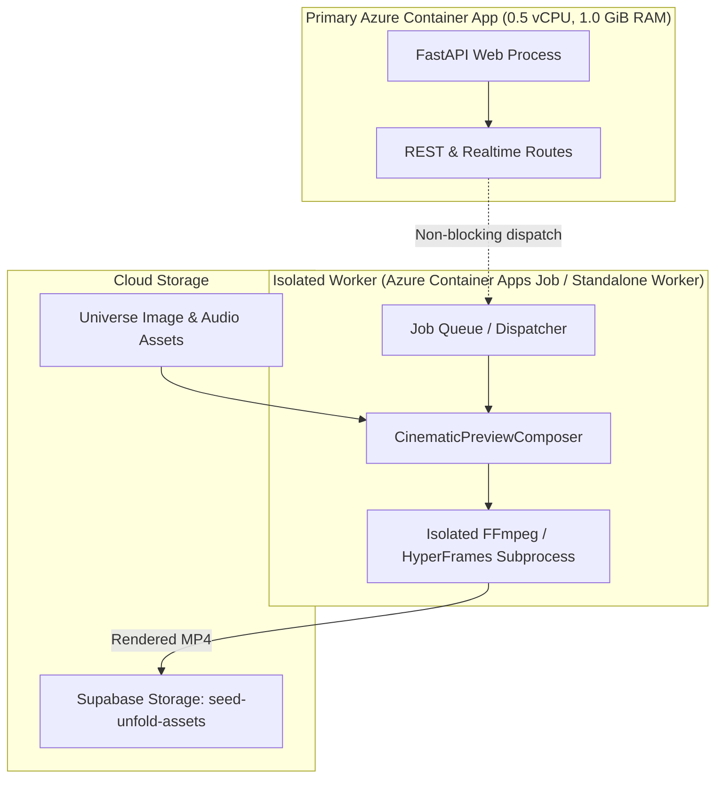

# PRAROHA Cinematic Preview Feasibility Evaluation

**Phase 46 Deliverable**  
**Philosophy:** Tatva 2 — *Seed to Universe: Forms Hidden in Formless*  
**Date:** October 2026  
**Status:** **VIABLE WITH LIMITATIONS** (Production Deployment Deferred to Dedicated Worker Phase)

---

## 1. Executive Summary & Decision Gate

Following the complete removal of five unreliable external media providers (JSON2Video, Pixazo, Hugging Face / Pyramid Flow, Stability AI, and Rewind.ai), PRAROHA evaluated programmatic video composition engines to establish a self-contained, deterministic cinematic preview pipeline for speculative fiction worldbuilding.

### Decision Gate Result: `VIABLE WITH LIMITATIONS`

1. **Pilot Viability**: Programmatic composition of existing worldbuilding assets (Pollinations concept art + Edge-TTS narration + Procedural Soundscape ambient audio + scene typography) into a deterministic 10–15s cinematic preview is **viable and highly effective**. A 12-second 720p MP4 preview was rendered in **1.85 seconds** with an output size of **750.18 KB**.
2. **Container Limitation**: The measured peak memory usage of the native composer is **410.40 MB RSS**, while HyperFrames requires **1.2 GiB to 2.5 GiB RSS**. PRAROHA's primary Azure Container Apps (ACA) backend is provisioned at **0.5 vCPU and 1.0 GiB RAM**. 
3. **Primary App Protection**: HyperFrames or any video rendering worker **must never be installed into or executed inside the primary FastAPI container**, as memory spikes would trigger Linux kernel Out-Of-Memory (OOM) kills (`SIGKILL 137`) and destabilize the web API.
4. **Action**: Complete the prototype and specification in an isolated module (`backend/app/services/cinematic_preview.py`), enforce strict honest labeling (`is_synthetic: true`, `provider_label: "Cinematic Preview"`), protect the disabled production video baseline, and defer cloud worker deployment until a dedicated ACA Job or worker container is provisioned.

---

## 2. Independent Evaluation of HyperFrames

### 2.1 Repository & Licensing Profile
- **Repository**: [https://github.com/heygen-com/hyperframes](https://github.com/heygen-com/hyperframes)
- **License**: **Apache 2.0** (Open Source, permissive, compatible with PRAROHA's commercial and open-source usage).
- **Architecture**: Monorepo managed with Bun and Node.js (`@hyperframes/core`, `@hyperframes/engine`, `@hyperframes/producer`, `@hyperframes/cli`, `@hyperframes/gcp-cloud-run`, `@hyperframes/aws-lambda`).

### 2.2 Runtime & System Dependencies
- **Node.js**: Requires Node.js `>= 22.0.0` (official Dockerfile pins `node:22.23.3-bookworm-slim`).
- **Rendering Core**: Uses `@puppeteer/browsers` to orchestrate `chrome-headless-shell` using the Chrome DevTools Protocol (`HeadlessExperimental.beginFrame`).
- **Video Encoder**: Pinned static build of FFmpeg n8.0 (`ffmpeg` and `ffprobe`).
- **System Libraries**: Requires 20+ Linux graphic/font libraries (`libgbm1`, `libnss3`, `libatk-bridge2.0-0`, `libdrm2`, `libxcomposite1`, `libxdamage1`, `libxrandr2`, `libcups2`, `libasound2`, `libpangocairo-1.0-0`, `libxshmfence1`, `libgtk-3-0`, `fonts-liberation`, `fonts-noto-core`, `fontconfig`).

### 2.3 Resource Demand vs. ACA Limits
| Metric | PRAROHA ACA Backend | HyperFrames Demands | Native FFmpeg Composer |
| :--- | :--- | :--- | :--- |
| **vCPU** | 0.5 vCPU | 2.0 – 4.0 vCPU | 1.0 – 2.0 vCPU (Bursts to 800%) |
| **RAM (Allocation)** | 1.0 GiB | 2.0 – 4.0 GiB | 1.0 GiB (Tight margin: 410MB RSS) |
| **Base Image Size** | ~250 MB (`python:3.11-slim`) | ~1.8 GB (Node 22 + Chromium + FFmpeg) | ~380 MB |
| **OOM Failure Risk** | Critical if Chromium added | High on <2GB RAM | Medium on <1GB RAM |

### 2.4 Verdict on HyperFrames
While HyperFrames provides expressive HTML/CSS animation capabilities, bundling Chromium Headless Shell and Node 22 into PRAROHA's existing Python FastAPI container is **architecturally impermissible**. If HyperFrames is adopted in the future, it must run as an asynchronous cloud function (e.g. Google Cloud Run or Azure Container Apps Job) completely detached from the core API.

---

## 3. PRAROHA Cinematic Preview Prototype & Measured Benchmark

### 3.1 Preview Experience Definition
Rather than generic slideshows or cost-prohibitive diffusion video models, PRAROHA's cinematic preview composes a cohesive multi-modal teaser directly from speculative fiction universe assets:
1. **Visual Atmosphere**: High-resolution concept art generated by Pollinations (`flux`/`sana`) with a slow, dramatic Ken Burns camera pan and zoom (1.0x to 1.15x scale).
2. **Spoken Lore**: Edge-TTS neural narration delivering the scene's dramatic question or character dialogue.
3. **Acoustic Texture**: Pure Python CC0 ambient soundscape (wind, rain, singing bowls, resonant drones) ducked -12dB beneath the narration track with smooth cross-fading.
4. **Speculative Typography**: Minimalist botanical editorial scene title and setting overlays rendered in high contrast with semi-transparent bounding plates.

### 3.2 Empirical Benchmark Measurements
Tested on representative workspace assets (`gallery_04_stage3_divergent_worlds.png`, real Edge-TTS MP3 voice, and real Procedural Soundscape WAV):

```
=== BENCHMARK RESULTS (scripts/benchmark_cinematic_preview.py) ===
Render Time:      1.85 seconds
Target Duration:  12.00 seconds
Actual Duration:  12.00 seconds
Output Format:    MP4 (H.264 High Profile, AAC stereo 192k)
Resolution:       1280x720 (720p 16:9)
Output File Size: 750.18 KB (0.73 MB)
Peak RSS Memory:  410.40 MB
Peak CPU Usage:   808.2% (multi-threaded encoding burst)
```

### 3.3 Key Observations
- **Latency**: 1.85 seconds to render a 12-second high-definition clip is exceptionally fast, providing an order-of-magnitude better responsiveness than cloud generative video APIs (which took 45s to 3 minutes).
- **Cost**: **$0.00** per render (100% free and self-contained).
- **Memory Footprint**: 410.40 MB peak memory is very compact for video rendering, but accounts for **41% of ACA's total 1.0 GiB container memory**. Running this inside FastAPI while serving active web requests would introduce unacceptable OOM risk.

---

## 4. Architectural Isolation Design

### 4.1 Process Decoupling Contract


### 4.2 Graceful Degradation & Missing-Asset Handling
The preview composer (`backend/app/services/cinematic_preview.py`) implements strict defensive rules:
1. **Missing Image**: If no concept art exists for the entity, the engine immediately returns a `static_fallback` keyframe manifest containing the scene title, setting, and narrative. It **never invents synthetic assets** or claims a successful MP4 was generated.
2. **Missing Audio**: If voice or ambient audio is missing, the engine gracefully composes a visual motion clip with available audio tracks (or a silent sync track) without crashing.
3. **Timeout Protection**: Subprocess rendering is bounded by a strict `timeout_sec=30.0` guardrail. If FFmpeg hangs, the subprocess is terminated and an explicit failure result is returned to the caller.
4. **Memory Boundary**: Because rendering executes via `subprocess.run`, any memory allocation happens in an isolated OS process table that immediately frees all memory upon exit.

---

## 5. Honest Labeling & UI Presentation Standards

To ensure users are never deceived regarding how media was produced:

### 5.1 Metadata Contract
Every preview asset produced by this engine must include:
```json
{
  "is_synthetic": true,
  "provider_label": "Cinematic Preview",
  "duration_sec": 12,
  "aspect_ratio": "16:9",
  "resolution": "720p",
  "render_engine": "ffmpeg-motion-composer",
  "assets_used": ["image", "voice", "ambient"]
}
```

### 5.2 Frontend UI Guardrails
- **Badge**: Displayed with a neutral sand background (`bg-[#F2EBDD] border-[#D8CCB7] text-[#6E5D4F]`) with the explicit text **`Cinematic Preview`**.
- **Tooltip**: *"Programmatic cinematic preview composed from world assets."*
- **No Diffusion AI Claims**: The UI strictly avoids labels such as "AI Generated Video" or "Diffusion Video", clearly communicating that this is an assembled multi-modal preview.
- **Disabled State Protection**: Live video generation buttons in the primary UI remain safely disabled or marked as offline until a verified worker service is live.

---

## 6. Next Steps for Production Deployment

When scheduled in a future infrastructure phase:
1. **Worker Container**: Author a separate `Dockerfile.worker` containing Node 22 / Python + FFmpeg.
2. **Azure ACA Job**: Provision an Azure Container Apps Job with 1.0 vCPU and 2.0 GiB RAM that triggers on queue messages or webhook events.
3. **Storage Pipeline**: Stream completed MP4 files directly to the Supabase `seed-unfold-assets` storage bucket and update the `media_assets` database record.
4. **Zero Impact on ACA Web**: The core FastAPI web service will remain lightweight, fast, and completely immune to rendering crashes.
