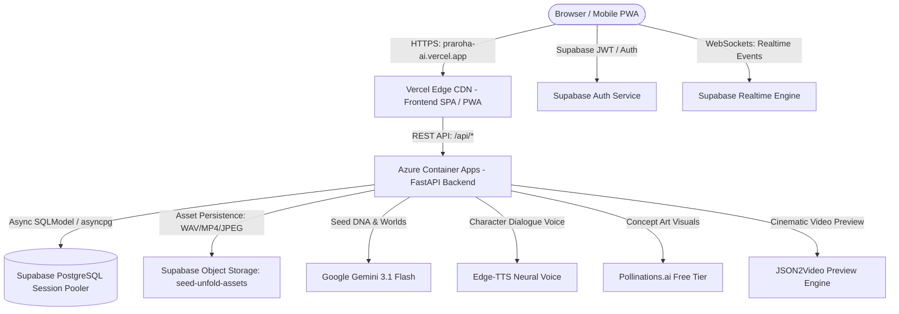
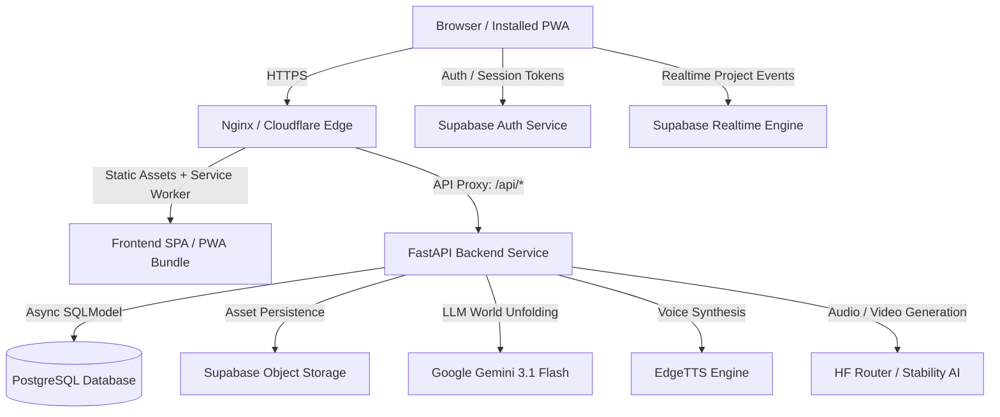
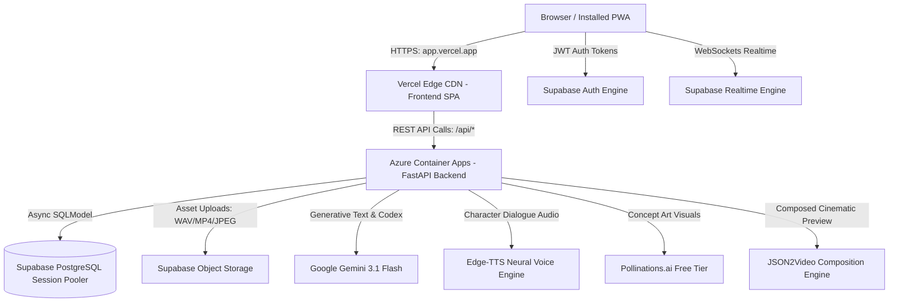

# PRAROHA — Production Deployment Guide & Operational Runbook

This guide covers deploying PRAROHA as a scalable, reliable production product with persistent database storage, durable cloud object storage, secure email authentication, and PWA capabilities.

---

## Live Cloud Production Deployment (Active)

PRAROHA is actively deployed and verified live in production on a decoupled serverless/containerized cloud architecture:

| Component | Cloud Platform | Live Production URL | Health / Verification |
| :--- | :--- | :--- | :--- |
| **Frontend (PWA)** | **Vercel Edge** | [`https://praroha-ai.vercel.app`](https://praroha-ai.vercel.app) *(Alias: `https://frontend-iota-green-73.vercel.app`)* | **Live & Verified** (HTTPS, Service Worker active) |
| **Backend API** | **Azure Container Apps** | [`https://praroha-backend.whiteground-dc69e38a.centralindia.azurecontainerapps.io`](https://praroha-backend.whiteground-dc69e38a.centralindia.azurecontainerapps.io) | **Live & Verified** (`/api/health` 200 OK) |
| **Database** | **Supabase PostgreSQL** | `https://stxnxkzaftmwcbtvgzbm.supabase.co` | **Live & Connected** (Session Pooler) |
| **Authentication** | **Supabase Auth** | `https://stxnxkzaftmwcbtvgzbm.supabase.co` | **Live & Configured** (Email Auth & JWT) |
| **Media Storage** | **Supabase Storage** | Bucket: `seed-unfold-assets` | **Live & Connected** (Persistent storage) |
| **Realtime Sync** | **Supabase Realtime** | `wss://stxnxkzaftmwcbtvgzbm.supabase.co/realtime/v1` | **Live & Connected** (WebSockets) |

### Active Cloud Architecture



---

## 1. System Architecture



---

## 2. Prerequisites & Credentials Checklist

| Component | Provider / Service | Environment Variable | Required in Production? |
| :--- | :--- | :--- | :--- |
| **Core LLM** | Google AI Studio | `GEMINI_API_KEY` | **Yes** (World unfolding, DNA extraction) |
| **Database** | Supabase Postgres / Neon | `DATABASE_URL` | **Yes** (Persistent project entities) |
| **Media Storage** | Supabase Storage | `STORAGE_PROVIDER=supabase`, `SUPABASE_URL`, `SUPABASE_KEY` | **Yes** (Avoids ephemeral container data loss) |
| **Visual Art (Images)** | Pollinations (Flux) | `POLLINATIONS_API_KEY` | Optional (Free tier default) |
| **Narration Voice** | Microsoft Edge-TTS | None | Built-in (Free, high-fidelity neural voices) |
| **Atmospheric Audio** | Procedural Soundscape Composer | None | Built-in (Free, CC0 multi-track synthesis) |
| **Video Generation** | Retired / Phase 46 Preview Engine | N/A | Retired due to unreliability / Currently Unavailable |

---

## 3. Production Deployment Options & Hosting Comparison

Choosing the appropriate hosting architecture requires balancing infrastructure complexity, operational overhead, and media synthesis workload characteristics.

### Architectural Comparison: Single-Host Docker Compose vs. Decoupled PaaS

| Dimension | Option A: Unified Docker Compose (VPS / Cloud VM) | Option B: Decoupled PaaS (Vercel + Render / Railway / Fly.io) |
| :--- | :--- | :--- |
| **Recommended Use Case** | **Recommended for PRAROHA Production** | Fast prototyping / Stateless APIs |
| **Origin / CORS** | **Unified Origin (`https://yourdomain.com`)**. Nginx reverse proxies `/api/*` to FastAPI on the internal Docker network. Zero CORS complexity or cross-origin cookie issues. | **Split Origins** (`https://app.vercel.app` & `https://api.render.com`). Requires strict `CORS_ORIGINS` setup and cross-origin header handling. |
| **Long-Running Media Jobs** | **Persistent Background Tasks**. FastAPI `asyncio.create_task` jobs (video composition, multi-track audio synthesis) execute to completion without interruption. | **High Risk of Aborted Jobs**. Free instances sleep after inactivity, instantly killing any in-flight background tasks. |
| **Proxy / HTTP Timeouts** | **Configurable**. Nginx `proxy_read_timeout` configured to `300s` in `deployment/nginx.conf` accommodates 60–120s video renders. | **Hard Ceilings**. Render free tier enforces a strict **100-second request timeout**; Vercel serverless functions time out after 10–15s (Hobby tier). |
| **Cold Starts & Sleeping** | **Zero Cold Starts**. Containers run persistently 24/7. | **Severe Sleeping**. Free web services (e.g. Render) spin down after 15 min of inactivity, incurring 50–60s cold starts on first user access. |
| **Upload & File Size** | **Full Control**. `client_max_body_size 50M;` allows multi-track WAV / MP4 transfers without HTTP 413 errors. | **Platform Limits**. Serverless body limits (typically 4.5MB on Vercel) prevent direct large file transfers. |
| **Memory / CPU Headroom** | **Predictable VM Resources**. Dedicated RAM and swap space ensure heavy image encoding and PCM WAV synthesis do not trigger OOM kills. | **Strict Memory Quotas**. Free tiers commonly restrict memory to 512MB RAM, causing spontaneous OOM restarts during media synthesis. |
| **Cost** | **$0 to $5/mo**. Free tier eligible on Oracle Cloud Always Free (4 OCPU, 24GB RAM ARM VM) or $4–$6/mo on Hetzner/DigitalOcean. | **$0 Free Tiers** (with severe operational restrictions noted above). |

---

### Option A: Unified Docker Compose (VPS / Cloud VM) — Recommended

Recommended for reliable production deployments on Ubuntu 22.04+ (Hetzner, DigitalOcean Droplet, AWS EC2, Linode, or Oracle Cloud Always Free).

#### 1. Free Cloud VM Provisioning & Hardware Architecture

##### Eligible Free Cloud Tiers
| Cloud Provider | Instance Shape | Architecture | CPU & RAM | Disk | Notes |
| :--- | :--- | :--- | :--- | :--- | :--- |
| **Oracle Cloud Always Free (Recommended)** | `VM.Standard.A1.Flex` | **ARM64 (aarch64)** | 4 OCPU, 24 GB RAM | 200 GB | Highest free headroom. Zero cold starts, handles PCM audio & image encoding effortlessly. |
| **Oracle Cloud Always Free (AMD)** | `VM.Standard.E2.1.Micro` | **x86_64 (amd64)** | 1 OCPU, 1 GB RAM | 50 GB | Requires 2GB swap file setup. |
| **Google Cloud Free Tier** | `e2-micro` | **x86_64 (amd64)** | 0.25–2 vCPU, 1 GB RAM | 30 GB | Eligible in us-central1, us-west1, or us-east1. |
| **AWS Free Tier (12-Mo Trial)** | `t2.micro` / `t4g.small` | x86_64 / arm64 | 1–2 vCPU, 1–2 GB RAM | 30 GB EBS | Requires 2GB swap file. |

##### Container Architecture Compatibility
- **AMD64 (`x86_64`)**: Native build on standard Intel/AMD VMs. No modifications needed.
- **ARM64 (`aarch64`)**: Fully compatible.
  - `python:3.11-slim`, `node:20-alpine`, and `nginx:1.25-alpine` provide official multi-arch images.
  - Python dependencies in `backend/requirements.txt` (`asyncpg`, `uvloop`, `pydantic-core`) publish pre-compiled `manylinux_aarch64` wheels on PyPI.
  - If building directly on an ARM64 host, run standard `docker compose up -d --build`.
  - If cross-building on x86 for an ARM64 VM, use Docker Buildx:
    ```bash
    docker buildx build --platform linux/arm64 -f Dockerfile.backend -t praroha-backend:arm64 .
    docker buildx build --platform linux/arm64 -f Dockerfile.frontend -t praroha-frontend:arm64 .
    ```

##### Network & Firewall Ingress Rules
Configure cloud security lists and OS-level firewall rules:
- **Port 22 (SSH)**: Allow from administrator IP only (or zero-trust access via Cloudflare Access).
- **Port 80 (HTTP)**: Allow `0.0.0.0/0` (required for ACME Let's Encrypt challenges and HTTP $\rightarrow$ HTTPS redirects).
- **Port 443 (HTTPS)**: Allow `0.0.0.0/0` (public encrypted application traffic).
- **Port 8000 (Backend API)**: **DENY / CLOSED to public internet** (internal Docker network only).
- **Port 5432 (Postgres DB)**: **DENY / CLOSED to public internet** (internal Docker network only).

On Ubuntu/Debian hosts, enforce with UFW:
```bash
sudo ufw default deny incoming
sudo ufw default allow outgoing
sudo ufw allow 22/tcp
sudo ufw allow 80/tcp
sudo ufw allow 443/tcp
sudo ufw enable
```

##### Host Swap Memory Configuration (for 1GB–2GB RAM VMs)
```bash
sudo fallocate -l 2G /swapfile
sudo chmod 600 /swapfile
sudo mkswap /swapfile
sudo swapon /swapfile
echo '/swapfile none swap sw 0 0' | sudo tee -a /etc/fstab
```

##### Prerequisites Installation
```bash
sudo apt-get update && sudo apt-get install -y docker.io docker-compose-v2 git jq
sudo systemctl enable --now docker
sudo usermod -aG docker $USER
```

#### 2. Clone the Repository & Workspace Setup
```bash
git clone https://github.com/syed-imadulla/Praroha.git
cd Praroha
```

#### 3. Configure Production Environment
```bash
cp .env.production.example .env.production
nano .env.production
```
Configure your production secrets:
- `GEMINI_API_KEY`: Production Google AI Studio API key.
- `DATABASE_URL`: Production Supabase PostgreSQL Session Pooler connection string (`postgresql+asyncpg://...`).
- `STORAGE_PROVIDER`: `supabase`
- `SUPABASE_URL`: `https://[project-id].supabase.co`
- `SUPABASE_KEY`: Supabase service role key (or anon key with appropriate bucket policies).
- `SUPABASE_BUCKET`: `seed-unfold-assets`
- `CORS_ORIGINS`: `https://yourdomain.com,http://localhost`

#### 4. Build and Launch Containers
```bash
docker compose -f docker-compose.prod.yml --env-file .env.production up -d --build
```

#### 5. Verify Health Checks
```bash
docker compose -f docker-compose.prod.yml ps
curl -s http://localhost/api/health | jq
```
Expected response: `"status": "healthy"`, `"service": "Seed Unfold (Praroha)"`.

#### 6. Production SSL/TLS Termination Runbook

##### Method 1: Certbot on Host (Standard Nginx Reverse Proxy)
If pointing a public domain to your VM's public IP:
```bash
sudo apt-get install -y certbot python3-certbot-nginx
sudo certbot certonly --standalone -d yourdomain.com -d www.yourdomain.com
```
Mount the generated certificates into `deployment/nginx.conf` and update the port binding from 80 to 443 in `docker-compose.prod.yml`.

##### Method 2: Cloudflare Tunnel (Recommended Zero-Trust Option)
Cloudflare Tunnel allows zero-port-forwarding, automatic SSL/TLS, and DDoS mitigation without exposing port 80/443 directly to the public internet:
1. Install `cloudflared` on the host:
   ```bash
   curl -L --output cloudflared.deb https://github.com/cloudflare/cloudflared/releases/latest/download/cloudflared-linux-amd64.deb
   sudo dpkg -i cloudflared.deb
   ```
2. Authenticate and create a tunnel:
   ```bash
   cloudflared tunnel login
   cloudflared tunnel create praroha-prod
   ```
3. Route incoming domain traffic to the local Nginx container:
   ```yaml
   # ~/.cloudflared/config.yml
   tunnel: <TUNNEL_UUID>
   credentials-file: /root/.cloudflared/<TUNNEL_UUID>.json
   ingress:
     - hostname: yourdomain.com
       service: http://localhost:80
     - service: http_status:404
   ```
4. Run tunnel service:
   ```bash
   sudo cloudflared service install
   sudo systemctl start cloudflared
   ```

---

### Option B: Decoupled PaaS (Vercel Frontend + Render/Railway Backend)

If single-host deployment is not viable, deploy using decoupled managed services while adhering to the following configuration constraints:

#### Frontend (Vercel / Netlify):
- **Framework Preset**: Vite
- **Root Directory**: `frontend`
- **Build Command**: `npm run build`
- **Output Directory**: `dist`
- **Environment Variables**:
  - `VITE_API_URL`: `https://api.yourdomain.com` (backend URL)
  - `VITE_SUPABASE_URL`: `https://[project-id].supabase.co`
  - `VITE_SUPABASE_ANON_KEY`: `[anon-key]`

#### Backend (Render / Railway / Fly.io):
- **Runtime**: Python 3.11 / Docker (`Dockerfile.backend`)
- **Port**: 8000
- **Health Check Path**: `/api/health`
- **Environment Variables**: Populate all variables from `.env.production.example`.
- **CORS Configuration**: Set `CORS_ORIGINS=https://your-frontend.vercel.app` (comma-separated).
- **Critical Operational Mitigations**:
  - *Keep-Alive Ping*: Configure an external uptime monitor (e.g. UptimeRobot or Better Uptime) calling `/api/health` every 10 minutes to prevent Render instances from spinning down and aborting media background jobs.
  - *Worker Timeout*: Ensure Gunicorn/Uvicorn timeout is set to 300s. Note that Render free tier web services still apply a strict 100-second network proxy cutoff.

---

### Option C: Cloud Production Architecture — Azure Container Apps + Vercel + Supabase

This is the standard managed cloud architecture for PRAROHA, decoupling edge static assets (Vercel) from containerized compute (Azure Container Apps) and managed persistence (Supabase).



#### 1. Backend on Azure Container Apps (ACA)

##### Build & Container Image Registry
Using Azure Container Registry (ACR):
```bash
# Build backend image directly in cloud ACR (no local Docker daemon required)
az acr build \
  --registry <YOUR_ACR_NAME> \
  --image praroha-backend:latest \
  --file Dockerfile.backend .
```

##### Deploy Container App
```bash
az containerapp create \
  --name praroha-backend \
  --resource-group <YOUR_RESOURCE_GROUP> \
  --environment <YOUR_CONTAINERAPP_ENV> \
  --image <YOUR_ACR_NAME>.azurecr.io/praroha-backend:latest \
  --target-port 8000 \
  --ingress external \
  --min-replicas 1 \
  --max-replicas 3 \
  --cpu 0.5 \
  --memory 1.0Gi \
  --env-vars \
    PROJECT_NAME="PRAROHA — Seed to Universe" \
    ENVIRONMENT="production" \
    AI_PROVIDER="gemini" \
    STORAGE_PROVIDER="supabase" \
    SUPABASE_BUCKET="seed-unfold-assets" \
    DEV_AUTO_CONFIRM_EMAILS="false" \
    CORS_ORIGINS="https://your-app.vercel.app,https://praroha.vercel.app" \
  --secrets \
    gemini-key="<YOUR_GEMINI_KEY>" \
    database-url="<YOUR_SUPABASE_DATABASE_URL>" \
    supabase-url="<YOUR_SUPABASE_URL>" \
    supabase-key="<YOUR_SUPABASE_SERVICE_ROLE_OR_ANON_KEY>" \
  --secret-env-vars \
    GEMINI_API_KEY=secretref:gemini-key \
    DATABASE_URL=secretref:database-url \
    SUPABASE_URL=secretref:supabase-url \
    SUPABASE_KEY=secretref:supabase-key
```

##### Background Job Recovery & Scale Configuration
- **Preventing Scale-to-Zero Interruption**: Configured with `--min-replicas 1` so in-flight `asyncio.create_task` operations (cinematic video renders, multi-layer audio synthesis) are never terminated by container scale-in.
- **Crash Recovery**: `backend/app/main.py` incorporates an automated startup recovery handler (`ProjectRepository.recover_orphaned_jobs`). If an ACA instance restarts or scales, any jobs interrupted in `queued` or `processing` states are automatically caught and transitioned to `failed` with actionable retry prompts so creators are never stuck waiting on dead jobs.
- **Health Probe**: Configured against `/api/health` on port 8000.

##### Cost & Free Tier Analysis (Azure Container Apps)
- Azure provides **180,000 vCPU-seconds** and **360,000 GiB-seconds** of free execution every month on the Consumption plan.
- At 0.5 vCPU and 1.0 GiB RAM with `minReplicas = 1`, the first 100 hours each month are completely covered by the free grant; continuous 24/7 execution costs ~$12–$15/month (or $0 covered by Azure for Students / Azure credits).

#### 2. Frontend on Vercel

##### Project Setup & Build Configuration
In the Vercel Dashboard or CLI (`npx vercel`):
- **Framework Preset**: Vite
- **Root Directory**: `frontend`
- **Build Command**: `npm run build`
- **Output Directory**: `dist`
- **SPA Rewrites & Caching**: Defined in `frontend/vercel.json` (rewriting all requests to `/index.html` and setting `no-cache` on `sw.js` and `manifest.webmanifest`).

##### Frontend Environment Variables (Vercel)
Configure in Vercel **Project Settings → Environment Variables**:
```dotenv
VITE_API_URL=https://praroha-backend.<region>.azurecontainerapps.io/api
VITE_SUPABASE_URL=https://<your-project-id>.supabase.co
VITE_SUPABASE_ANON_KEY=<your-public-anon-key>
```
*Note: ApiClient in `frontend/src/api/client.ts` automatically normalizes `VITE_API_URL` to guarantee consistent `/api` routing regardless of trailing slashes.*

---

## 4. Supabase Setup Checklist

### A. Authentication & Redirects
In your Supabase Dashboard:
1. Navigate to **Authentication → URL Configuration**.
2. Set **Site URL** to `https://yourdomain.com`.
3. Add **Redirect URLs**:
   - `https://yourdomain.com/**`
   - `https://yourdomain.com/reset-password`
4. Under **Email Templates**:
   - Verify that the Confirmation and Password Reset emails link to your site URL.
5. In **Auth Settings**:
   - Ensure **Confirm email** is enabled for production account security.

### B. Storage Bucket
1. Navigate to **Storage → Buckets**.
2. Create a bucket named `seed-unfold-assets`.
3. Toggle **Public Bucket** to ON (so generated voice MP3s, concept art, and videos can be rendered in the browser).
4. Add an RLS policy granting `SELECT` to public and `INSERT/UPDATE` to authenticated users or service role.

---

## 5. Operational Health & Monitoring

### Health Endpoint
Monitor uptime using:
```bash
GET /api/health
```
Response:
```json
{
  "success": true,
  "data": {
    "status": "healthy",
    "service": "Seed Unfold (Praroha)",
    "environment": "production",
    "ai_provider": {
      "configured": "gemini",
      "resolved": "gemini",
      "model": "gemini-3.1-flash-lite",
      "status": "healthy"
    },
    "storage_provider": {
      "configured": "supabase",
      "type": "SupabaseStorageProvider",
      "status": "ready"
    }
  }
}
```

### Logging
FastAPI outputs structured JSON/text logs to standard error/out:
```bash
docker compose -f docker-compose.prod.yml logs -f backend
```

---

## 6. Disaster Recovery & Rollback

### Database Backup
Automate daily backups of PostgreSQL:
```bash
pg_dump -Fc "$DATABASE_URL" > praroha_backup_$(date +%F).dump
```

### Rollback Procedure
If a deployment fails:
1. Re-tag or check out the last stable Git commit.
2. Rebuild containers:
   ```bash
   git checkout <stable-commit-hash>
   docker compose -f docker-compose.prod.yml build
   docker compose -f docker-compose.prod.yml up -d
   ```
3. Inspect container health:
   ```bash
   docker compose -f docker-compose.prod.yml ps
   ```
