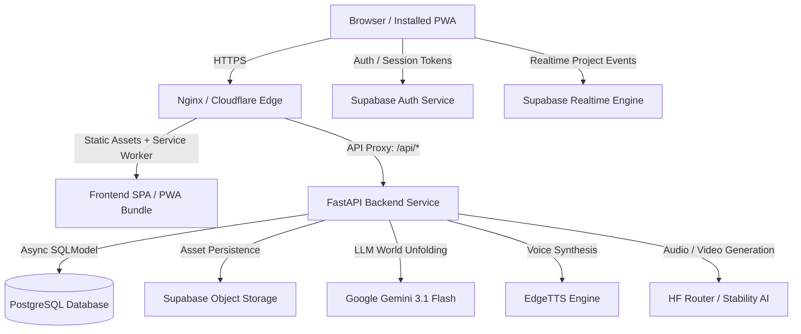

# PRAROHA — Production Deployment Guide & Operational Runbook

This guide covers deploying PRAROHA as a scalable, reliable production product with persistent database storage, durable cloud object storage, secure email authentication, and PWA capabilities.

---

## 1. System Architecture



---

## 2. Prerequisites & Credentials Checklist

| Component | Provider / Service | Environment Variable | Required in Production? |
| :--- | :--- | :--- | :--- |
| **Core LLM** | Google AI Studio | `GEMINI_API_KEY` | **Yes** (World unfolding, DNA extraction) |
| **Database** | Supabase Postgres / Neon | `DATABASE_URL` | **Yes** (Persistent project entities) |
| **Media Storage** | Supabase Storage | `STORAGE_PROVIDER=supabase`, `SUPABASE_URL`, `SUPABASE_KEY` | **Yes** (Avoids ephemeral container data loss) |
| **Authentication** | Supabase Auth | `SUPABASE_URL`, `SUPABASE_KEY` | **Yes** (User registration & email verification) |
| **Atmospheric Audio** | Hugging Face Router or Stability AI | `HF_TOKEN` or `STABILITY_API_KEY` | Optional (Required for live audio generation) |
| **Video Generation** | Hugging Face Router | `HF_TOKEN` | Optional (Required for live video generation) |

---

## 3. Production Deployment Options

### Option A: Unified Docker Compose (VPS / Cloud VM)
Recommended for single-node deployments on Ubuntu 22.04+ (Hetzner, DigitalOcean Droplet, AWS EC2, Linode).

1. **Clone the Repository & Navigate to Workspace**:
   ```bash
   git clone https://github.com/syed-imadulla/Praroha.git
   cd Praroha
   ```

2. **Configure Production Environment**:
   ```bash
   cp .env.production.example .env.production
   nano .env.production
   ```
   Fill in your production `GEMINI_API_KEY`, `DATABASE_URL`, and Supabase credentials.

3. **Build and Launch Containers**:
   ```bash
   docker compose -f docker-compose.prod.yml --env-file .env.production up -d --build
   ```

4. **Verify Health**:
   ```bash
   curl -I http://localhost/
   curl -s http://localhost/api/health | jq
   ```

5. **SSL/TLS Termination**:
   Use Certbot or a Cloudflare Tunnel in front of port 80 to terminate HTTPS with automated renewal:
   ```bash
   sudo certbot --nginx -d yourdomain.com
   ```

---

### Option B: Decoupled PaaS (Vercel Frontend + Render/Railway Backend)

#### Frontend (Vercel / Netlify):
- **Framework Preset**: Vite
- **Root Directory**: `frontend`
- **Build Command**: `npm run build`
- **Output Directory**: `dist`
- **Environment Variables**:
  - `VITE_API_URL`: `https://api.yourdomain.com` (if backend is on a separate subdomain)
  - `VITE_SUPABASE_URL`: `https://[project-id].supabase.co`
  - `VITE_SUPABASE_ANON_KEY`: `[anon-key]`

#### Backend (Render / Railway / Fly.io):
- **Runtime**: Python 3.11 / Docker (`Dockerfile.backend`)
- **Port**: 8000
- **Health Check Path**: `/api/health`
- **Environment Variables**: Set variables from `.env.production.example`. Ensure `CORS_ORIGINS` includes your frontend domain.

---

## 4. Supabase Setup Checklist

### A. Authentication & Redirects
In your Supabase Dashboard:
1. Navigate to **Authentication → URL Configuration**.
2. Set **Site URL** to `https://yourdomain.com`.
3. Add **Redirect URLs**:
   - `https://yourdomain.com/**`
   - `https://yourdomain.com/reset-password`
4. Under **Email Templates**:
   - Verify that the Confirmation and Password Reset emails link to your site URL.
5. In **Auth Settings**:
   - Ensure **Confirm email** is enabled for production account security.

### B. Storage Bucket
1. Navigate to **Storage → Buckets**.
2. Create a bucket named `seed-unfold-assets`.
3. Toggle **Public Bucket** to ON (so generated voice MP3s, concept art, and videos can be rendered in the browser).
4. Add an RLS policy granting `SELECT` to public and `INSERT/UPDATE` to authenticated users or service role.

---

## 5. Operational Health & Monitoring

### Health Endpoint
Monitor uptime using:
```bash
GET /api/health
```
Response:
```json
{
  "success": true,
  "data": {
    "status": "healthy",
    "service": "Seed Unfold (Praroha)",
    "environment": "production",
    "ai_provider": {
      "configured": "gemini",
      "resolved": "gemini",
      "model": "gemini-3.1-flash-lite",
      "status": "healthy"
    },
    "storage_provider": {
      "configured": "supabase",
      "type": "SupabaseStorageProvider",
      "status": "ready"
    }
  }
}
```

### Logging
FastAPI outputs structured JSON/text logs to standard error/out:
```bash
docker compose -f docker-compose.prod.yml logs -f backend
```

---

## 6. Disaster Recovery & Rollback

### Database Backup
Automate daily backups of PostgreSQL:
```bash
pg_dump -Fc "$DATABASE_URL" > praroha_backup_$(date +%F).dump
```

### Rollback Procedure
If a deployment fails:
1. Re-tag or check out the last stable Git commit.
2. Rebuild containers:
   ```bash
   git checkout <stable-commit-hash>
   docker compose -f docker-compose.prod.yml build
   docker compose -f docker-compose.prod.yml up -d
   ```
3. Inspect container health:
   ```bash
   docker compose -f docker-compose.prod.yml ps
   ```
