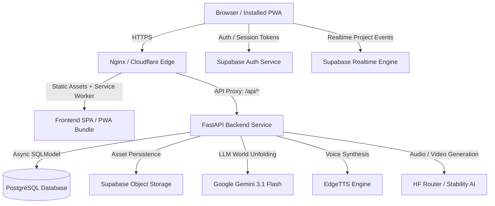

# PRAROHA — Production Deployment Guide & Operational Runbook

This guide covers deploying PRAROHA as a scalable, reliable production product with persistent database storage, durable cloud object storage, secure email authentication, and PWA capabilities.

---

## 1. System Architecture



---

## 2. Prerequisites & Credentials Checklist

| Component | Provider / Service | Environment Variable | Required in Production? |
| :--- | :--- | :--- | :--- |
| **Core LLM** | Google AI Studio | `GEMINI_API_KEY` | **Yes** (World unfolding, DNA extraction) |
| **Database** | Supabase Postgres / Neon | `DATABASE_URL` | **Yes** (Persistent project entities) |
| **Media Storage** | Supabase Storage | `STORAGE_PROVIDER=supabase`, `SUPABASE_URL`, `SUPABASE_KEY` | **Yes** (Avoids ephemeral container data loss) |
| **Authentication** | Supabase Auth | `SUPABASE_URL`, `SUPABASE_KEY` | **Yes** (User registration & email verification) |
| **Atmospheric Audio** | Hugging Face Router or Stability AI | `HF_TOKEN` or `STABILITY_API_KEY` | Optional (Required for live audio generation) |
| **Video Generation** | Hugging Face Router | `HF_TOKEN` | Optional (Required for live video generation) |

---

## 3. Production Deployment Options & Hosting Comparison

Choosing the appropriate hosting architecture requires balancing infrastructure complexity, operational overhead, and media synthesis workload characteristics.

### Architectural Comparison: Single-Host Docker Compose vs. Decoupled PaaS

| Dimension | Option A: Unified Docker Compose (VPS / Cloud VM) | Option B: Decoupled PaaS (Vercel + Render / Railway / Fly.io) |
| :--- | :--- | :--- |
| **Recommended Use Case** | **Recommended for PRAROHA Production** | Fast prototyping / Stateless APIs |
| **Origin / CORS** | **Unified Origin (`https://yourdomain.com`)**. Nginx reverse proxies `/api/*` to FastAPI on the internal Docker network. Zero CORS complexity or cross-origin cookie issues. | **Split Origins** (`https://app.vercel.app` & `https://api.render.com`). Requires strict `CORS_ORIGINS` setup and cross-origin header handling. |
| **Long-Running Media Jobs** | **Persistent Background Tasks**. FastAPI `asyncio.create_task` jobs (video composition, multi-track audio synthesis) execute to completion without interruption. | **High Risk of Aborted Jobs**. Free instances sleep after inactivity, instantly killing any in-flight background tasks. |
| **Proxy / HTTP Timeouts** | **Configurable**. Nginx `proxy_read_timeout` configured to `300s` in `deployment/nginx.conf` accommodates 60–120s video renders. | **Hard Ceilings**. Render free tier enforces a strict **100-second request timeout**; Vercel serverless functions time out after 10–15s (Hobby tier). |
| **Cold Starts & Sleeping** | **Zero Cold Starts**. Containers run persistently 24/7. | **Severe Sleeping**. Free web services (e.g. Render) spin down after 15 min of inactivity, incurring 50–60s cold starts on first user access. |
| **Upload & File Size** | **Full Control**. `client_max_body_size 50M;` allows multi-track WAV / MP4 transfers without HTTP 413 errors. | **Platform Limits**. Serverless body limits (typically 4.5MB on Vercel) prevent direct large file transfers. |
| **Memory / CPU Headroom** | **Predictable VM Resources**. Dedicated RAM and swap space ensure heavy image encoding and PCM WAV synthesis do not trigger OOM kills. | **Strict Memory Quotas**. Free tiers commonly restrict memory to 512MB RAM, causing spontaneous OOM restarts during media synthesis. |
| **Cost** | **$0 to $5/mo**. Free tier eligible on Oracle Cloud Always Free (4 OCPU, 24GB RAM ARM VM) or $4–$6/mo on Hetzner/DigitalOcean. | **$0 Free Tiers** (with severe operational restrictions noted above). |

---

### Option A: Unified Docker Compose (VPS / Cloud VM) — Recommended

Recommended for reliable production deployments on Ubuntu 22.04+ (Hetzner, DigitalOcean Droplet, AWS EC2, Linode, or Oracle Cloud Always Free).

#### 1. Server Provisioning & Prerequisites
Install Docker Engine and Docker Compose V2 on the host:
```bash
sudo apt-get update && sudo apt-get install -y docker.io docker-compose-v2 git jq
sudo systemctl enable --now docker
```

#### 2. Clone the Repository & Workspace Setup
```bash
git clone https://github.com/syed-imadulla/Praroha.git
cd Praroha
```

#### 3. Configure Production Environment
```bash
cp .env.production.example .env.production
nano .env.production
```
Configure your production secrets:
- `GEMINI_API_KEY`: Production Google AI Studio API key.
- `DATABASE_URL`: Production Supabase PostgreSQL Session Pooler connection string (`postgresql+asyncpg://...`).
- `STORAGE_PROVIDER`: `supabase`
- `SUPABASE_URL`: `https://[project-id].supabase.co`
- `SUPABASE_KEY`: Supabase service role key (or anon key with appropriate bucket policies).
- `SUPABASE_BUCKET`: `seed-unfold-assets`
- `CORS_ORIGINS`: `https://yourdomain.com,http://localhost`

#### 4. Build and Launch Containers
```bash
docker compose -f docker-compose.prod.yml --env-file .env.production up -d --build
```

#### 5. Verify Health Checks
```bash
docker compose -f docker-compose.prod.yml ps
curl -s http://localhost/api/health | jq
```
Expected response: `"status": "healthy"`, `"service": "Seed Unfold (Praroha)"`.

#### 6. Production SSL/TLS Termination Runbook

##### Method 1: Certbot on Host (Standard Nginx Reverse Proxy)
If pointing a public domain to your VM's public IP:
```bash
sudo apt-get install -y certbot python3-certbot-nginx
sudo certbot certonly --standalone -d yourdomain.com -d www.yourdomain.com
```
Mount the generated certificates into `deployment/nginx.conf` and update the port binding from 80 to 443 in `docker-compose.prod.yml`.

##### Method 2: Cloudflare Tunnel (Recommended Zero-Trust Option)
Cloudflare Tunnel allows zero-port-forwarding, automatic SSL/TLS, and DDoS mitigation without exposing port 80/443 directly to the public internet:
1. Install `cloudflared` on the host:
   ```bash
   curl -L --output cloudflared.deb https://github.com/cloudflare/cloudflared/releases/latest/download/cloudflared-linux-amd64.deb
   sudo dpkg -i cloudflared.deb
   ```
2. Authenticate and create a tunnel:
   ```bash
   cloudflared tunnel login
   cloudflared tunnel create praroha-prod
   ```
3. Route incoming domain traffic to the local Nginx container:
   ```yaml
   # ~/.cloudflared/config.yml
   tunnel: <TUNNEL_UUID>
   credentials-file: /root/.cloudflared/<TUNNEL_UUID>.json
   ingress:
     - hostname: yourdomain.com
       service: http://localhost:80
     - service: http_status:404
   ```
4. Run tunnel service:
   ```bash
   sudo cloudflared service install
   sudo systemctl start cloudflared
   ```

---

### Option B: Decoupled PaaS (Vercel Frontend + Render/Railway Backend)

If single-host deployment is not viable, deploy using decoupled managed services while adhering to the following configuration constraints:

#### Frontend (Vercel / Netlify):
- **Framework Preset**: Vite
- **Root Directory**: `frontend`
- **Build Command**: `npm run build`
- **Output Directory**: `dist`
- **Environment Variables**:
  - `VITE_API_URL`: `https://api.yourdomain.com` (backend URL)
  - `VITE_SUPABASE_URL`: `https://[project-id].supabase.co`
  - `VITE_SUPABASE_ANON_KEY`: `[anon-key]`

#### Backend (Render / Railway / Fly.io):
- **Runtime**: Python 3.11 / Docker (`Dockerfile.backend`)
- **Port**: 8000
- **Health Check Path**: `/api/health`
- **Environment Variables**: Populate all variables from `.env.production.example`.
- **CORS Configuration**: Set `CORS_ORIGINS=https://your-frontend.vercel.app` (comma-separated).
- **Critical Operational Mitigations**:
  - *Keep-Alive Ping*: Configure an external uptime monitor (e.g. UptimeRobot or Better Uptime) calling `/api/health` every 10 minutes to prevent Render instances from spinning down and aborting media background jobs.
  - *Worker Timeout*: Ensure Gunicorn/Uvicorn timeout is set to 300s. Note that Render free tier web services still apply a strict 100-second network proxy cutoff.

---

## 4. Supabase Setup Checklist

### A. Authentication & Redirects
In your Supabase Dashboard:
1. Navigate to **Authentication → URL Configuration**.
2. Set **Site URL** to `https://yourdomain.com`.
3. Add **Redirect URLs**:
   - `https://yourdomain.com/**`
   - `https://yourdomain.com/reset-password`
4. Under **Email Templates**:
   - Verify that the Confirmation and Password Reset emails link to your site URL.
5. In **Auth Settings**:
   - Ensure **Confirm email** is enabled for production account security.

### B. Storage Bucket
1. Navigate to **Storage → Buckets**.
2. Create a bucket named `seed-unfold-assets`.
3. Toggle **Public Bucket** to ON (so generated voice MP3s, concept art, and videos can be rendered in the browser).
4. Add an RLS policy granting `SELECT` to public and `INSERT/UPDATE` to authenticated users or service role.

---

## 5. Operational Health & Monitoring

### Health Endpoint
Monitor uptime using:
```bash
GET /api/health
```
Response:
```json
{
  "success": true,
  "data": {
    "status": "healthy",
    "service": "Seed Unfold (Praroha)",
    "environment": "production",
    "ai_provider": {
      "configured": "gemini",
      "resolved": "gemini",
      "model": "gemini-3.1-flash-lite",
      "status": "healthy"
    },
    "storage_provider": {
      "configured": "supabase",
      "type": "SupabaseStorageProvider",
      "status": "ready"
    }
  }
}
```

### Logging
FastAPI outputs structured JSON/text logs to standard error/out:
```bash
docker compose -f docker-compose.prod.yml logs -f backend
```

---

## 6. Disaster Recovery & Rollback

### Database Backup
Automate daily backups of PostgreSQL:
```bash
pg_dump -Fc "$DATABASE_URL" > praroha_backup_$(date +%F).dump
```

### Rollback Procedure
If a deployment fails:
1. Re-tag or check out the last stable Git commit.
2. Rebuild containers:
   ```bash
   git checkout <stable-commit-hash>
   docker compose -f docker-compose.prod.yml build
   docker compose -f docker-compose.prod.yml up -d
   ```
3. Inspect container health:
   ```bash
   docker compose -f docker-compose.prod.yml ps
   ```
