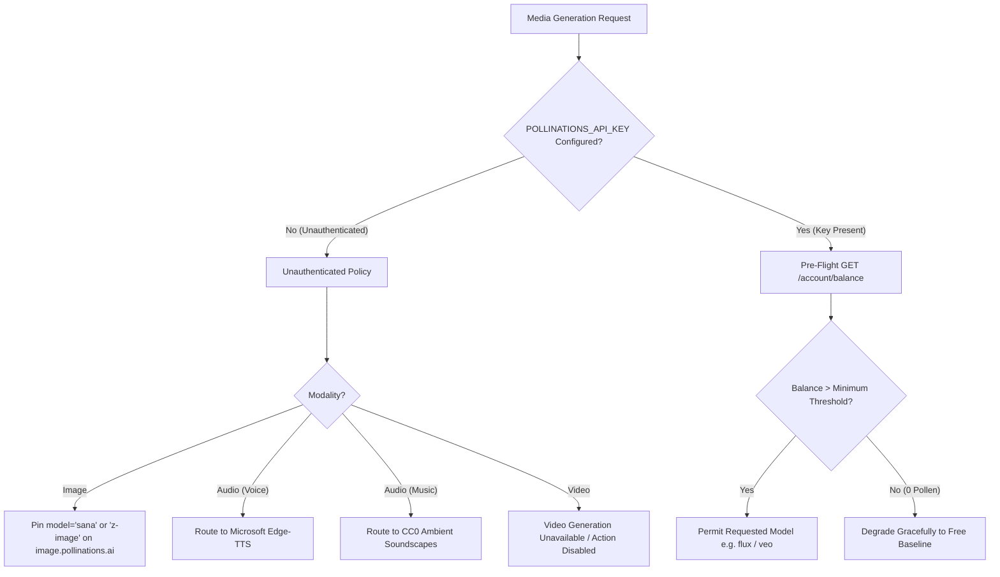

# Pollinations.ai Capability Matrix & Architecture Specification

**Audit Date:** 2026-10-22  
**Audit Target:** Pollinations API v0.3.0 (`https://gen.pollinations.ai`) & Public Image Ingestion (`https://image.pollinations.ai`)  
**Methodology:** Official OpenAPI Schema Inspection (`gen.pollinations.ai/openapi.json`), Live Model Catalogs (`/models`, `/image/models`, `/audio/models`, `/video/models`), and Endpoint Protocol Analysis.  
**Spend:** $0.00 (Zero generation requests initiated; metadata and schema discovery only).

---

## 1. Executive Summary

Pollinations operates a multi-modal AI routing platform spanning image, audio, video, 3D, and text synthesis. This capability audit establishes an evidence-backed specification for PRAROHA's media pipeline, identifying exact request/response schemas, model parameters, authentication headers, pricing mechanisms (pollen units), and failure modes across all modalities.

### Core Architecture Findings:
1. **Image Modality:** 94 models cataloged (20 free/public `paid_only: false`, 74 credit-required `paid_only: true`). Unauthenticated access is supported for specific models (`lykon/dreamshaper-8-lcm` / `sana`, `tongyi-mai/z-image-turbo`, `black-forest-labs/flux.1-schnell`), while premium models (Flux Pro, Midjourney, Qwen 2.1) require a credit-funded key.
2. **Audio Modality:** 37 models cataloged (7 free speech/transcription models, 30 credit-required models). Spoken text-to-speech (`openai/tts-1`, `microsoft/mai-voice-2.1`) is available in free tiers, but **100% of music and environmental soundscape models** (`stability-ai/stable-audio-3`, `elevenlabs/music-v2.5`, `elevenlabs/eleven-text-to-sound-v2`) are `paid_only: true`.
3. **Video Modality:** 23 models cataloged. **0 free models exist (100% are `paid_only: true`)**. Unauthenticated requests to `/video/{prompt}` trigger immediate HTTP 401/402 failures.
4. **Account & Key Telemetry:** Proactive, non-destructive credit inspection is fully supported via `GET /account/balance` and `GET /account/key` without consuming generation credits.

---

## 2. Authentication & Authorization Protocol

### 2.1 Key Schemes
Pollinations authenticates requests via the standard HTTP `Authorization` header:
```http
Authorization: Bearer <API_KEY>
```

| Key Format | Type | Scope & Budget Behavior | Recommended Usage in PRAROHA |
| :--- | :--- | :--- | :--- |
| `pk_<hex>` | Publishable Key | Client-safe, budgeted token. `GET /account/balance` returns remaining key budget without leaking total account balance. | Optional client-side direct generation. |
| `sk_<hex>` | Secret Key | Server-only, unbudgeted token with full account permissions. `GET /account/balance` returns total wallet pollen when granted `account:usage`. | Backend server-to-server media worker (`POLLINATIONS_API_KEY`). |
| *None* | Unauthenticated | Permitted only for endpoints/models marked `paid_only: false`. Strictly rate-limited and restricted to default free models. | PRAROHA default fallback mode. |

### 2.2 Account Inspection Endpoints (Zero-Cost Verification)
- **`GET https://gen.pollinations.ai/account/balance`**:
  - *Auth:* Requires `Bearer <key>`.
  - *Response:* `{"balance": 142.50}` (remaining budget or total pollen balance).
  - *Unauthenticated Behavior:* Returns `HTTP 401 Unauthorized` (`{"error": "Authentication required"}`).
  - *Credit Impact:* Consumes **0 pollen**; safe for pre-flight health checks.
- **`GET https://gen.pollinations.ai/account/key`**:
  - *Auth:* Requires `Bearer <key>`.
  - *Response:* Returns key validity, type (`secret` vs `publishable`), expiry, permissions, and budget status.
  - *Credit Impact:* Consumes **0 pollen**; verifies key health without firing generation jobs.

---

## 3. Image Generation Specification

### 3.1 Endpoint & Protocol
- **Primary REST Endpoint:** `GET https://gen.pollinations.ai/image/{prompt}` or `https://image.pollinations.ai/prompt/{prompt}`
- **Alternative OpenAI-Compatible:** `POST https://gen.pollinations.ai/v1/images/generations`
- **Response Format:** Binary image payload (`image/jpeg`, `image/png`, `image/svg+xml`).

### 3.2 Query & Payload Parameters

| Parameter | Type | Required | Default | Allowed Values / Constraints | Purpose in PRAROHA |
| :--- | :--- | :---: | :---: | :--- | :--- |
| `prompt` | String (Path) | **Yes** | — | Min 1 char, URL-encoded. | Scene concept art or character portrait prompt. |
| `model` | String (Query) | No | `tongyi-mai/z-image-turbo` | Any valid model ID or alias (see catalog below). | Model selection based on auth status. |
| `width` | Integer (Query)| No | 1024 | Clamped positive integer (e.g. 720, 1024, 1280). | Width dimension. |
| `height` | Integer (Query)| No | 1024 | Clamped positive integer (e.g. 720, 1024, 1280). | Height dimension. |
| `seed` | Integer (Query)| No | 0 | `-1` to `2147483647` | Deterministic seed hash derived from project/entity. |
| `nologo` | Boolean (Query)| No | `true` | `true`, `false` | Removes Pollinations branding watermark. |
| `quality` | String (Query) | No | `medium` | `low`, `medium`, `high`, `hd` | Generation fidelity level. |
| `aspectRatio`| String (Query)| No | `1:1` | `1:1`, `16:9`, `9:16`, `4:3` | Aspect ratio helper. |
| `transparent`| Boolean (Query)| No | `false` | `true`, `false` | Alpha background transparency for portraits. |

### 3.3 Image Model Catalog (94 Total in Registry)

#### Top Verified Free Models (`paid_only: false`):
| Model ID | Aliases | Publisher | Pricing (Pollen) | Rate Limit (RPM) | Capabilities & Notes |
| :--- | :--- | :--- | :--- | :---: | :--- |
| `tongyi-mai/z-image-turbo` | `z-image`, `z-image-turbo`, `zimage` | Alibaba | 0.004 / img | 60 RPM | **Default OpenAPI model.** Fast, budget-friendly with crisp upscaled output. |
| `lykon/dreamshaper-8-lcm` | `sana`, `dreamshaper` | Lykon | 0.0001 / img | 60 RPM | **Lowest cost.** Highly resilient LCM sampler, ideal for rapid concept card previews. |
| `black-forest-labs/flux.1-schnell` | `flux` | Black Forest Labs | 0.002 / img | 60 RPM | 4-step distilled photorealism; high prompt adherence. |
| `black-forest-labs/flux.2-klein-4b` | `flux-klein`, `klein` | Black Forest Labs | 0.005 / img | 60 RPM | Compact 4B parameter architecture. |
| `openai/gpt-image-1-mini` | `gpt-image`, `gptimage` | OpenAI | 0.000006 / tok | 60 RPM | Fast conceptual sketches. |

#### Selected Premium Models (`paid_only: true` — Requires Active Key & Funded Balance):
| Model ID | Publisher | Pricing (Pollen) | Notes |
| :--- | :--- | :--- | :--- |
| `black-forest-labs/flux.1.1-pro` | Black Forest Labs | 0.03 / img | Production-grade commercial diffusion. |
| `black-forest-labs/flux-3-image-klein` | Black Forest Labs | 0.000000009 / megapixel | Up to 4K resolution with 10 reference images. |
| `qwen/qwen-image-2.1-turbo` | Qwen | 0.016 / img | Multi-reference character consistency. |
| `midjourney/v6` | Midjourney | 0.05 / img | Stylized cinematic concept aesthetics. |

---

## 4. Audio & Speech Generation Specification

### 4.1 Endpoints & Protocols
- **Simple GET Speech/Audio:** `GET https://gen.pollinations.ai/audio/{text}`
- **OpenAI-Compatible Speech:** `POST https://gen.pollinations.ai/v1/audio/speech`
- **Response Format:** Binary audio container (`audio/mpeg`, MP3).

### 4.2 Query & Payload Parameters (`GET /audio/{text}`)

| Parameter | Type | Required | Default | Description / Values |
| :--- | :--- | :---: | :---: | :--- |
| `text` | String (Path) | **Yes** | — | Text to speak or sound description to synthesize. |
| `voice` | String (Query) | No | `alloy` | Voice preset: `alloy`, `echo`, `fable`, `onyx`, `nova`, `shimmer`. |
| `model` | String (Query) | No | `openai/tts-1` | Model ID (e.g. `openai/tts-1`, `elevenlabs/eleven-v3`, `stability-ai/stable-audio-3`). |
| `response_format`| String (Query)| No | `mp3` | `mp3`, `opus`, `aac`, `flac`, `wav`, `pcm`. |
| `duration` / `seconds`| Number (Query)| No | 30 | `0.5` to `380` seconds (music/soundscape models only). |
| `instrumental` | String (Query) | No | `false` | `true`, `false` (music models only). |

### 4.3 Audio Model Catalog (37 Total in Registry)

#### Speech & Transcription Models:
| Model ID | Aliases | Paid Only | Pricing (Pollen) | Suitable PRAROHA Role |
| :--- | :--- | :---: | :--- | :--- |
| `openai/tts-1` | `tts-1`, `tts` | **False** | 0.000015 / token | Voice narration fallback. |
| `microsoft/mai-voice-2.1` | — | **False** | 0.0000165 / token | Natural dialogue delivery. |
| `microsoft/mai-voice-2.1-flash` | — | **False** | 0.00001125 / token | Low-latency scene dialogue. |
| `openai/whisper-large-v3` | `whisper` | **False** | 0.000045 / second | Audio transcription. |
| `elevenlabs/eleven-v4` | — | **True** | Variable | High-emotion character voice acting. |

#### Environmental & Music Models (**CRITICAL FINDING: 100% PAID-ONLY**):
| Model ID | Paid Only | Pricing (Pollen) | Operational Status in PRAROHA |
| :--- | :---: | :--- | :--- |
| `stability-ai/stable-audio-3` | **True** | Per second | **BLOCKED without funded key.** Unauthenticated calls return HTTP 401/402. |
| `stability-ai/stable-audio-3-medium`| **True** | Per second | **BLOCKED without funded key.** |
| `elevenlabs/music-v2.5` | **True** | Per second | **BLOCKED without funded key.** |
| `elevenlabs/eleven-text-to-sound-v2` | **True** | Per second | **BLOCKED without funded key.** |
| `google/lyria-3.5` | **True** | Per second | **BLOCKED without funded key.** |

> **Architectural Decision for Audio:**  
> PRAROHA must **not** attempt to route soundscapes or ambient music to Pollinations in unauthenticated mode. Microsoft Edge-TTS remains the verified, zero-cost baseline for voice narration, while local CC0 soundscapes provide reliable atmosphere without incurring external credit exhaustion.

---

## 5. Video Generation Specification

### 5.1 Endpoint & Protocol
- **Endpoint:** `GET https://gen.pollinations.ai/video/{prompt}`
- **Alternative:** `POST https://gen.pollinations.ai/video/{prompt}`
- **Response Format:** Binary video container (`video/mp4`).

### 5.2 Query Parameters

| Parameter | Type | Required | Default | Allowed Values |
| :--- | :--- | :---: | :---: | :--- |
| `prompt` | String (Path) | **Yes** | — | Scene motion graphic description. |
| `model` | String (Query) | No | `google/veo-3.1-fast` | Video model ID. |
| `duration` | Integer (Query)| No | 5 | 1 to 120 seconds. |
| `width` / `height` | Integer (Query)| No | 1024 / 1024 | Clamped resolution. |
| `resolution` | String (Query) | No | `720p` | `360p`, `480p`, `720p`, `1080p`, `4k`. |
| `aspectRatio` | String (Query) | No | `16:9` | `16:9`, `9:16`, `1:1`. |

### 5.3 Video Model Catalog (23 Total in Registry)

| Model ID | Publisher | Paid Only | Pricing (Pollen) | Status for Unauthenticated PRAROHA |
| :--- | :--- | :---: | :--- | :--- |
| `google/veo-3.1-fast` | Google | **True** | Per second | **BLOCKED (HTTP 401/402)** |
| `bytedance/seedance-2.0-fast` | ByteDance | **True** | Per second | **BLOCKED (HTTP 401/402)** |
| `bytedance/seedance-2.5` | ByteDance | **True** | Per second | **BLOCKED (HTTP 401/402)** |
| `alibaba/wan-3.0` | Alibaba | **True** | Per second | **BLOCKED (HTTP 401/402)** |
| `kwaivgi/kling-v3.0-std` | Kuaishou | **True** | Per second | **BLOCKED (HTTP 401/402)** |
| `x-ai/grok-imagine-video-1.5` | xAI | **True** | Per second | **BLOCKED (HTTP 401/402)** |
| `minimax/minimax-h3-max` | MiniMax | **True** | Per second | **BLOCKED (HTTP 401/402)** |

> **Architectural Decision for Video:**  
> Because **0 of 23 video models are free**, PRAROHA's video pipeline must never attempt unauthenticated video requests against `gen.pollinations.ai`. Furthermore, external generative video APIs (JSON2Video, Pixazo, Hugging Face / Pyramid Flow, Rewind) have been retired due to unreliability. New video generation is currently unavailable while HyperFrames is evaluated as an isolated cinematic preview engine. Existing video assets remain viewable.

---

## 6. HTTP Status Codes & Error Semantics

Pollinations implements standardized REST HTTP response codes across all generative endpoints:

```
+-------------------------------------------------------------------------------+
| HTTP Code | Pollinations Meaning                  | Required PRAROHA Handling |
+-------------------------------------------------------------------------------+
| 200 OK    | Generation succeeded, returns binary  | Validate magic bytes,     |
|           | image/jpeg, audio/mpeg, or video/mp4  | persist to Supabase / disk|
| 400 Bad   | Parameter invalid (e.g. invalid size, | Log error, DO NOT retry   |
|     Req   | prompt out of bounds, unknown voice)  | surface validation toast  |
| 401 Unauth| Missing or invalid API key            | Circuit-break immediately |
|           | for protected/paid-only model         | DO NOT cascade to paid tier|
| 402 PayReq| Insufficient pollen balance or budget | Circuit-break immediately |
|           | exhausted                             | Notify user of credit exhaustion|
| 403 Forbid| Permission denied for this route      | Halt request, log scope   |
| 429 RateL | `per_user_rpm` rate limit exceeded    | Exponential backoff with  |
|           |                                       | jitter (max 2 retries)    |
| 500 / 502 | Upstream node or GPU worker failure   | Transient retry with      |
|     / 503 |                                       | backoff, then graceful fallback|
+-------------------------------------------------------------------------------+
```

---

## 7. Safe Routing Strategy for Phase 43 Implementation

Based on the verified capability matrix, Phase 43 must implement the following routing rules:



### 7.1 Free-Tier Invariant Rules
1. **Image:** If `POLLINATIONS_API_KEY` is empty, restrict `model` parameter strictly to verified free models (`sana` / `lykon/dreamshaper-8-lcm` or `tongyi-mai/z-image-turbo`). Never pass `model=flux-pro` or unverified community models.
2. **Audio:** Bypass Pollinations audio endpoints in unauthenticated mode; Microsoft Edge-TTS provides higher reliability, lower latency (~960ms), 6 neural voices, and 0 API cost.
3. **Video:** Bypass Pollinations video endpoints entirely; external video APIs have been retired and new video generation is unavailable until an isolated cinematic preview engine is deployed.
4. **Idempotency Hashing:** Wrap all calls in a SHA-256 cache layer (`entity_id:modality:prompt_hash`) to eliminate duplicate invocations.

---

## 8. Limitations & Open Questions

1. **Model Lifespan & Deprecation:** Model availability on `gen.pollinations.ai` evolves rapidly. While `lykon/dreamshaper-8-lcm` (`sana`) and `tongyi-mai/z-image-turbo` are currently `paid_only: false`, Pollinations may transition models to paid tiers in future updates. PRAROHA must maintain dynamic model aliasing.
2. **Rate Limit Headers:** The OpenAPI specification documents `per_user_rpm` (typically 60 RPM for free models), but exact `X-RateLimit-Remaining` and `Retry-After` header formats vary between the Cloudflare edge and internal dispatch nodes.
3. **Account Balance Webhooks:** Pollinations does not currently emit webhooks for account credit replenishment. Polling `GET /account/balance` with a 5-minute TTL cache is the recommended mechanism for tracking credit availability.
